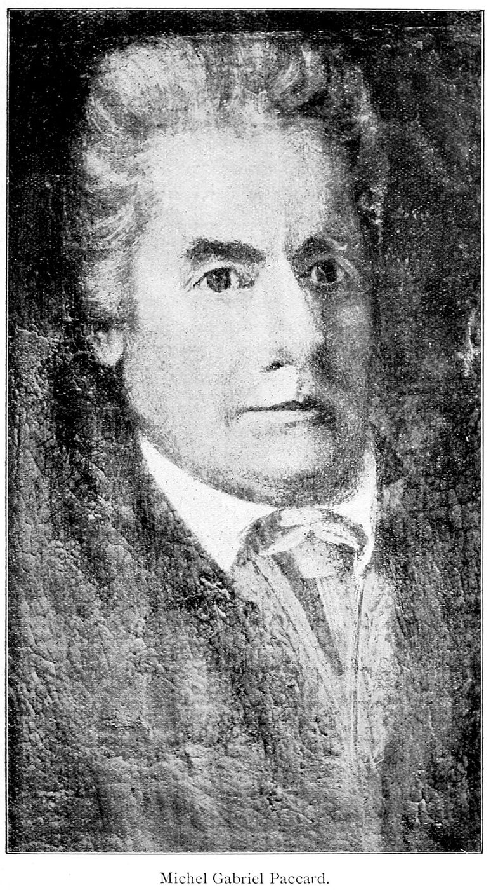
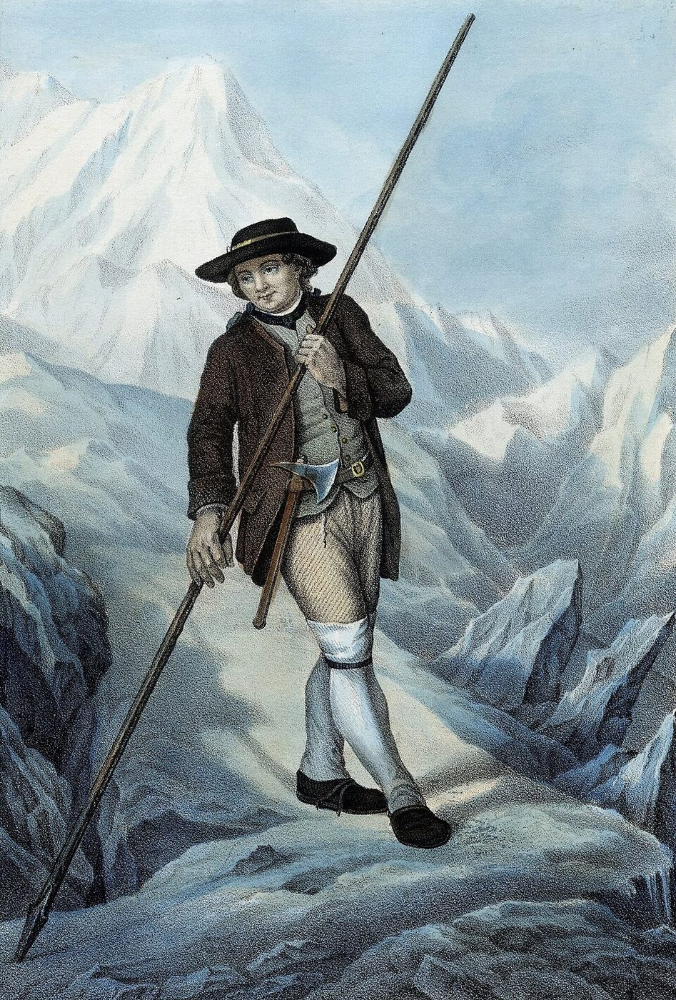
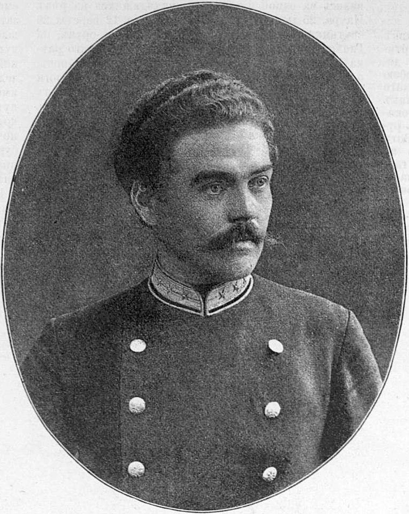

# История и система подготовки

## Откуда взялась школа

Днём рождения альпинизма считают 8 августа 1786 года: Мишель Паккард и охотник Жак Бальма поднялись на Монблан. Первовосхождение — первое в истории восхождение на вершину. В 1829 году Килар Хаширов первым поднялся на Восточную вершину Эльбруса. Группа Флоренса Грова с Ахией Соттаевым вышла на Западную в 1874 году, но высшая точка точно не подтверждена. Документально подтверждённое восхождение Андрея Пастухова относится к 1890 году, записку нашли в 1935-м. Устав Русского горного общества утвердили в конце 1900 года, учредительное собрание прошло весной 1901-го: общество строило приюты на Кавказе и выдавало книжки проводникам.

Килара Хаширова, Флоренса Грова и Ахию Соттаева здесь нет. Прижизненного портрета Хаширова не сохранилось, а отдельных фотографий Грова и Соттаева в открытых источниках не нашлось. Поздние рисунки и памятники показывают уже не их лица.

14 июля 1865 года семь человек группы Эдварда Уимпера впервые поднялись на Маттерхорн. На спуске они шли одной связкой: все были привязаны к одной верёвке, и по пути никто не закрепил её за скалу. Такая точка поймала бы падающего и не дала бы ему тащить остальных. Точек не было, поэтому верёвка людей только соединяла. Один поскользнулся и потянул за собой следующих троих. Между четвёртым и теми, кто шёл выше, оказался самый тонкий кусок из взятых верёвок. Он лопнул. Четверо погибли, трое остались на гребне именно потому, что верёвка порвалась. Отсюда два вывода, которые курс повторяет дальше. Связка без промежуточных точек срыв не держит: незакреплённая верёвка не останавливает падающего, а утаскивает тех, кто с ним связан. И верёвку выбирают под нагрузку, которую ей придётся выдержать, а не из того, что осталось в рюкзаке: тонкий кусок в середине связки рвётся первым и рвётся на человеке.

До революции в России на вершины ходили немногие и учились сами. Учить страховке всех начали со сборов Василия Семеновского. В 1929 году он собрал группу на поляне Миссес-кош в Безенги на месяц: движение по скалам, снегу и льду, страховка и быт в горах. Участники назвали сборы «Рабфак во льдах», по школам, где взрослых учили с азов. Следом открылись лагеря в Баксанском и Цейском ущельях, на Домбае и в Адыл-су. В 1934 году появился значок «Альпинист СССР». Чтобы его получить, нужно было пройти маршруты определённой сложности, и для этого понадобилась единая классификация. В её разработке участвовал математик и альпинист Борис Делоне.

В те же годы альпинизм в стране впервые вышел на большие высоты. В 1933 году экспедиция шла на высочайшую вершину страны. Тогда она называлась пик Сталина, позже пик Коммунизма, 7495 метров. До вершины дошёл один Евгений Абалаков. Горы от 7000 метров называют семитысячниками, от 8000 метров — восьмитысячниками. Восьмитысячников на Земле четырнадцать, и пик Коммунизма до этой границы не дотягивает. Для советского альпинизма это всё равно была первая настоящая высота, и взял её один человек.

Через три года, в 1936-м, братья Абалаковы поднялись на Хан-Тенгри, 6995 метров. Вершину взяли, а на спуске группу застала буря. Виталий Абалаков тяжело обморозился, их спутник Лоренц Саладин погиб. После этого спуска Виталий сделал главным правилом безопасность, а не саму вершину. К ней готовятся заранее. Высоту набирают постепенно, чтобы тело успело привыкнуть. По пути ставят промежуточные лагеря, чтобы не идти от подножия до вершины за один раз. Внизу дежурит спасательный отряд. И спуск считают частью маршрута: на него оставляют силы, время и погодное окно. Иначе группа, которая уже стоит на вершине, не может с неё уйти.

Этот осторожный стиль держался много лет. Его высшая точка — пик Победы в 1956 году. На вершину 7439 метров поднялись уже не один человек, а одиннадцать.

На пике Ленина, 7134 метра, случились две разные катастрофы. Путать их нельзя: одна про позднее решение уйти вниз, другая про место, где поставили палатки.

В августе 1974 года восемь альпинисток погибли в урагане на спуске с вершины. Высота и ветер забирают силы быстрее, чем это чувствуется внизу. Уходить вниз решают, пока группа ещё может идти. Если ждать, пока станет совсем плохо, сил на спуск уже нет.

В июле 1990 года землетрясение спустило ледовую лавину на лагерь на высоте около 5300 метров. Погибли 43 человека. Палатки стояли там, где стояли и в другие годы. Место для лагеря выбирают с учётом всего, что может прийти сверху, даже если на этой поляне «всегда стояли».

Разряды, жетоны и лагеря к этим двум катастрофам не привязаны: они складывались раньше и отдельно. С 1946 года альпинистам присваивают спортивные разряды. В 1965 году в классификацию добавили маршруты шестой категории, самые сложные. В 1963 году появился жетон «Спасательный отряд»: в районах создали общественные спасательные отряды, а позже жетон стал обязательным, чтобы получить первый разряд. В 1947 году Иван Антонович провёл на скалах Домбая первые в мире официальные соревнования по скалолазанию. В 1967 году Федерация альпинизма СССР вступила в UIAA, Международный союз альпинистских ассоциаций. Жетон «Снежный барс» дают тому, кто поднялся на все семитысячники бывшего Союза.

Главное высотное восхождение этой школы — Эверест в 1982 году. Готовились больше трёх лет и выбрали ещё не пройденный путь по контрфорсу юго-западной стены, тогда самый сложный маршрут на вершину. До экспедиции ни один советский альпинист не был выше 7600 метров. С 4 по 9 мая на вершину поднялись одиннадцать человек. Первыми были Владимир Балыбердин и Эдуард Мысловский.

Для общей картины рядом стоят и другие восхождения. 29 мая 1953 года Эдмунд Хиллари и Тенцинг Норгей впервые поднялись на Эверест. В 1978 году Райнхольд Месснер и Петер Хабелер поднялись туда без кислородных баллонов, а в 1986-м Месснер первым прошёл все четырнадцать восьмитысячников. В 1990 году российская команда прошла южную стену Лхоцзе. В 1997-м команда Сергея Ефимова прошла западную стену Макалу и получила за неё «Золотой ледоруб», международную премию за восхождение. В январе 2021 года непальская команда впервые зимой поднялась на К2, вторую вершину мира. Это был последний восьмитысячник, на который ещё не поднимались зимой.

Федерация альпинизма России объединяет 64 региональные федерации и развивает ледолазание, скайраннинг и ски-альпинизм. В декабре 2019 года ЮНЕСКО включило альпинизм в список нематериального культурного наследия. Сегодня ходят малыми группами, с минимумом снаряжения и максимумом свободного лазания. Альпинизм в этом курсе — восхождения на вершины и маршруты по скалам, снегу и льду со специальной техникой и снаряжением. Восхождение — подъём на вершину по определённому маршруту вместе со спуском, и такие единицы идут в книжку альпиниста и в документы для аттестации.

Первопрохождение — первое прохождение нового пути на уже покорённую вершину. Инструктор-методист учит внутри спортивной системы. Инструктор-проводник аттестован по закону о туризме, и право работать даёт запись в реестре. Разряд, даже высокий, права водить клиентов за плату не даёт.

## Учебные группы

В лагере группу до сих пор зовут НП-1, НП-2, СП, СС и ВСМ. Программа ФАР называет те же ступени языком закона о физической культуре и спорте. Спортивно-оздоровительный этап, СО, раньше в программе отсутствовал и не обязателен: его проводят отдельно или внутри начальной подготовки, а первым этапом может быть сразу НП. Начальная подготовка, НП, имя сохранила. Учебно-тренировочный этап, УТ, заменил спортивную подготовку, СП. Спортивное совершенствование, СС, имя сохранило.

Высшее спортивное мастерство, СМ, — прежний ВСМ, внутри него уровни СМ-1, СМ-2 и СМ-3. Квалификационный уровень — объём знаний, умений и зачётных восхождений, после которого человека ставят в следующую группу, и этот уровень не является ни разрядом, ни категорией маршрута. Этап закрыт, когда пройдены все занятия, зачёты сданы с положительной оценкой и сделаны зачётные восхождения. Инструктор пишет закрытие в книжку альпиниста, часть II «Квалификационные уровни альпиниста». Следующую группу комплектуют после закрытия предыдущего этапа. На СО приходят те, кто альпинизмом ещё не занимался: отдельная подготовка до выезда не обязательна, нужны нормативы по общей физической подготовке и допуск врача.

Человек узнаёт рельеф и опасности, вяжет узлы, ходит по перилам, по некрутому снегу и по льду до 30° в кошках, переправляется простым бродом и переносит легко пострадавшего. Зачёт — одно восхождение 1Б с инструктором. Если лёд и снег на сборе провести не удалось, а остальные занятия и восхождение 1Б сделаны, выдают удостоверение и знак «Альпинист России», пропущенное добирают на НП или позже. В старой речи лагеря этот сезон называли НП-1. Значок 1934 года «Альпинист СССР» сегодняшним знаком не является, и путаница этих двух документов завышает опыт. Начальная подготовка начинается до выезда и продолжается в горах, половинным набором тем её не закрывают.

Человек ходит по простому рельефу, страхует через плечо, поясницу, выступ и устройство, собирает станцию на двух и трёх точках, идёт по закрытому леднику в связке, переправляется вброд и по перилам. Зачётные восхождения, все с инструктором: два маршрута 1Б, два 2А и один 2Б. Этот набор совпадает с третьим разрядом. Второй год лагеря называли НП-2, отдельного кода НП-2 теперь нет. Учебно-тренировочный этап в лагере делили на СП-1, начало второго разряда, и СП-2, его закрытие и первый опыт руководства. Срок в программе — два года, он может быть другим, и тогда пропорционально времени меняют объём физической подготовки, а не список умений.

К концу человек ходит по рельефу 3Б, сам задерживается при срыве на снегу, организует станцию и спуск группы по закреплённой верёвке, оказывает первую помощь и с инструктором поднимает пострадавшего из трещины. Он умеет руководить восхождением 2-й категории: оформить выход, держать решение и не отдавать безопасность на голосование. Зачёт — пять восхождений с инструктором и одно руководителем, по норме второго разряда: два 3Б, три 3А и одно 2Б руководителем. Второй разряд программа называет началом подготовки к сложным восхождениям. На спортивном совершенствовании выполняют первый разряд. Человек идёт свободным лазанием и с ледовыми инструментами по рельефу 5А, проходит короткие сложные куски на искусственных точках, организует спуск группы из двух–шести человек и транспортировку малой группой.

Зачёт — восхождения 4А–5А в спортивных группах и руководство 3А–3Б, расчётные два года. Быстрее или медленнее меняется физическая подготовка, список восхождений остаётся. Высшее мастерство рассчитано на три года, срок тоже может сдвинуться, и каждый уровень начинается после предыдущего. СМ-1 — восхождения 5Б с положительной аттестацией. СМ-2 — 5Б, в том числе 5Б в двойке по комбинированному маршруту, затем 6А с положительной аттестацией. СМ-3 — 6А и затем 6Б с положительной аттестацией.

Здесь человек сам выбирает маршрут по уровню и форме, планирует автономный выход, ночёвку в любую погоду и запасной сход. Восхождение без положительной аттестации в уровень не встаёт. Первое восхождение сложнее программы этапа разрешено, занятия им не заменяют. Для первых 2А, 2Б и 3А нужны учебный цикл этой сложности и один маршрут предыдущей полукатегории. Для первых 3Б и выше нужны полный цикл и уже два маршрута предыдущей полукатегории. Скальный маршрут с пометкой «ск» требует занятий по скалам и спасработам данной сложности. Комбинированный и ледово-снежный, пометки «к» и «лс», добавляют снег, микст и лёд. Выход на лёд после сданных скал и пропущенного льда оставляет человека без приёмов этого пути.

## Разряды и звания

Разряды считают по Единой всероссийской спортивной классификации, нормы классического альпинизма — по Правилам вида спорта «альпинизм» с изменениями приказа Минспорта от 14 февраля 2024 года № 170. Классы: технический, высотно-технический, высотный, ледово-снежный и первопрохождений. Запись «2/3А» значит два восхождения категории 3А. Одна звёздочка — одно из отмеченных восхождений ледово-снежное или комбинированное, две — двойка, три — человек шёл руководителем, четыре — первопрохождение. Более сложное восхождение заменяет более простое. Зачёт идёт в группе от двух человек, разряды выполняют по порядку, и первый не закрывают без второго.

Третий разряд одинаков для мужчин и женщин: одно 2Б, два 2А и два 1Б, тот же набор, которым закрывают НП. Его засчитывают на соревнованиях не ниже чемпионата муниципального образования, судьи видят действия на месте. Второй разряд тоже одинаков: два 3Б, три 3А и одно 2Б руководителем, вместо него можно засчитать руководительское 2А, соревнования того же уровня. Все маршруты, пройденные только участником, второй разряд не закрывают. Первый разряд у мужчин: два 5А, одно из них ледово-снежное или комбинированное, одно 4Б, одно 4Б в двойке, одно 4А, одно 4А в двойке и одно 3Б руководителем, которое можно заменить руководительским 3А. У женщин: два 5А, одно из них ледово-снежное или комбинированное, два 4А, два 4Б и одно 3Б руководителем либо одно 3А руководителем.

Присваивают на соревнованиях не ниже других официальных соревнований субъекта Российской Федерации. Кандидат в мастера спорта у мужчин — одно 6А, два 5Б, из них одно ледово-снежное или комбинированное, и одно 5А в двойке. У женщин — два 5Б, из них одно ледово-снежное или комбинированное. КМС присваивают не ниже чемпионата федерального округа, двух и более округов, Москвы или Санкт-Петербурга. Мастер спорта считается баллами за четыре года: не меньше 25, из них не меньше 10 на чемпионатах России и из этих десяти не меньше пяти в дисциплине «класс — технический». Место на чемпионате России даёт 10, 8, 7, 6, 5, 4, 3, 2 и 1 балл с первого по девятое.

На чемпионате округа, двух и более округов, Москвы или Санкт-Петербурга — 5, 4, 3, 2 и 1 с первого по пятое. Сами маршруты дают 1 балл за 5Б, 2 за 6А, 3 за 6Б и ещё балл за двойку, или за первопрохождение либо первовосхождение, или за зиму, или за высоту выше 6900 м. Мужчине нужно одно 6Б, женщине — одно 6А. Мастер спорта международного класса у мужчин — три 6Б, среди них одно в двойке и одно первопрохождение. У женщин — два 6Б, и среди них одно ледово-снежное или комбинированное, либо в двойке, либо первопрохождение. МСМК присваивают на международных соревнованиях не ниже других международных из единого календарного плана.

Повторно разряд закрывают одним восхождением участником: КМС — маршрут 5Б, первый разряд — 5А, второй — 3Б, третий — 2Б. Заслуженный мастер спорта — почётное звание, в таблице ЕВСК его нет, и числом шестёрок его не закрывают. Учебный этап говорит, какую группу комплектовать. Разряд говорит, что засчитано по классификации. Категория от 1Б до 6Б оценивает альпинистский маршрут, правовая от I до VI — туристский. Ни этап, ни разряд, ни жетон «Спасательный отряд», ни знак «Альпинист России» права на платную услугу не дают. Его даёт запись в реестре на нужные вид и категорию. Выход с клиентами по разряду или по группе СП — работа без допуска.

## Категории маршрутов и участки

Цифра маршрута ничего не значит, пока не названа шкала. У вершины своя категория трудности по рекомендациям ФАР от 9 сентября 2002 года, у перевала — по методике категорирования горных перевалов, у туристского маршрута в законе — от I до VI по приказу Минэкономразвития № 340 и распоряжению Правительства № 1365-р. Знаки 1Б, 2А и III друг в друга не переводятся. Маршруты восхождений делят на шесть категорий, от 1Б до 6Б. Со второй по шестую у каждой две полукатегории: А проще, Б сложнее. Полукатегория — эта половинка.

В категорию входит только путь подъёма. Подход и спуск описывают в отчёте отдельно, при траверсе спуск считают с последней вершины. Для классификации траверс — прохождение не меньше двух вершин, когда спуск с предыдущей идёт к следующей, а не обратно по пути подъёма. Одна вершина с возвратом тем же путём траверсом не является. В широком смысле так называют и гребневой путь через несколько вершин, и движение поперёк склона. Безенгийская стена даёт образец первого смысла: тринадцать километров гребня, Гестола, Катынтау, Джангитау и Шхара 5193 м, траверсы 5Б и 6А, первый с востока на запад в 1938 году, первый зимний в 2014 году.

Оценку ставят при обычной погоде и обычном рельефе, по всем участкам вместе. Предварительную дают первопроходцы сравнением с маршрутами той же полукатегории, которые сами ходили. Окончательную присваивает только классификационная комиссия ФАР, 6Б после её рекомендации утверждает правление, и до решения категорию первопрохождения в книжку не пишут. Рядом с категорией стоят пометки. «пв» — первовосхождение, «пп» — первопрохождение, «вар» — вариант, «ком» — комбинация пройденных участков, «е» — шлямбуры, «з» — зима, и это не седьмая категория, «д/гр» — зачёт только конкретной группе, для учёбы не рекомендован. Ниже классифицированных лежат некатегорийные маршруты: они легкодоступны, специальная подготовка и снаряжение не нужны.

1А доступен, части группы уже нужна первоначальная подготовка, на отдельных участках страхуют верёвкой. 1Б длиннее: нужен объём, который рекомендации называют программой НП-1, на маршруте работают снаряжением и приёмами страховки, обычно ночуют под маршрутом, такие пути рекомендуют на знак «Альпинист России». С 2А полукатегорию определяют сравнением с классическими маршрутами, а не таблицей метров. Крымская 1Б короче и технически плотнее кавказской, и крымскую таблицу на большой горный маршрут не переносят. Категория пути собирается из участков. Маршрут делят по характерным местам, свободное лазание и искусственные точки пишут раздельно.

Градация участка — оценка куска, а не всего восхождения. Свободное лазание имеет шесть градаций, у каждой ступени «−» и «+»: I очень лёгкое, II лёгкое, III среднее, IV трудное, V очень трудное, VI чрезвычайно трудное. Градация VI — участок над надёжной страховкой, предельно сложный рельеф и очень маленькие зацепки. Его свободным лазанием идут лучшие в лучшей форме, в хороших условиях и современной обуви, на грани срыва. Дальше в описании указывают незащищённость, ориентировку, видно ли напарника, камнепад и лавины, условия страховки, длину, набор, время и число крючьев, места без возврата и возможный аварийный спуск. Искусственные точки опоры — точки, на которые опираются или за которые подтягиваются.

А1 — одиночные крючья и подсаживание, рельеф прост и надёжен. А2 — серия точек при том же простом рельефе. А3 — большие серии, нужна вторая верёвка, рельеф сложнее, на пути карнизы и навесы. А4 — большие серии, снова вторая верёвка, рельеф сложный и ненадёжный, карнизы большие. Буква «е» после градации значит шлямбуры или отверстия под скайхуки, запись «V+е» — пятая градация, верхняя ступень, и шлямбуры. Стационарные шлямбуры на схеме обозначают «Т».

Эта буква категорией маршрута не является и восток не обозначает. Перевалы идут шкалой н/к, 1А, 1Б, 2А, 2Б, 3А, 3Б, выше 3Б её нет. Звезда, например 2А*, значит, что от сезона и снега перевал может стать на полукатегорию труднее, группе нужен опыт следующей. У 3Б* нужен опыт не меньше двух перевалов 3Б. В зачёт звезду не оставляют, по факту пишут однозначную категорию. По методике 1А — склоны до 30°, пологие ледники без трещин, самостраховка ледорубом, несколько часов, точек нет.

1Б — склоны 20–45°, закрытые ледники, одновременное движение, до суток и до пяти точек. 2А — та же крутизна и несложные ледопады, попеременная или перильная страховка, кошки, до суток и примерно 5–10 точек. 2Б — круче 45°, стены до 10–15 м, дюльфер, не меньше суток. 3А — склоны 45–65°, стены в одну–две верёвки, искусственные опоры, до двух суток. 3Б — те же формы длиннее, непрерывная страховка, возможны висячие ночёвки, не меньше двух суток. Перевал 2А и маршрут 2А на вершину описывают разное: у перевала смотрят склон, лёд, точки и время, у вершины — путь подъёма рядом с классикой той же полукатегории.

В договоре стоит правовая категория от I до VI. От неё зависит право вести группу: в реестре нужны тот же вид и та же категория либо работа в бригаде на одну выше. «Горный маршрут III категории» — правовая запись, альпинистская 3Б и перевал 3А в неё не подставляются. Цифра без имени шкалы — повод спросить. Французские F, PD, AD, D, TD и ED описывают маршрут целиком, от «легко» до «экстремально трудно».

Официального перевода в 1Б–6Б нет, соответствие остаётся грубым ориентиром, путь сверяют по описанию. В категории для проводника сидят техника, протяжённость, высота и серьёзность. Погода и длина дня делают простой маршрут серьёзным, описание сверяют со свежими отчётами. Это теория: навык чтения категории и ведения группы осваивают очно, а текст не является допуском и не заменяет аттестацию.
