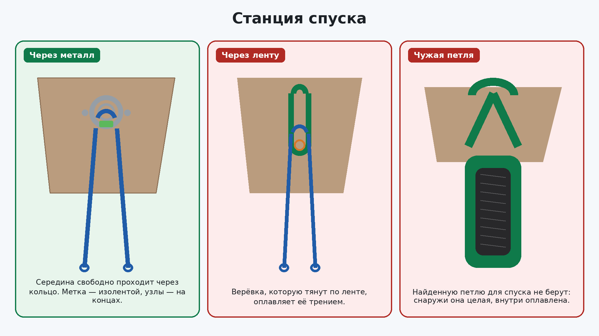

# Перила, спуск и подъём

## Перила

Перила — закреплённая верёвка, по которой группа поднимается, спускается или траверсирует на самостраховке. Навешивает их самый опытный, инструктор или ведущий. Он проходит участок с нижней страховкой, и лезет первым всегда на динамической верёвке: статика не погасит срыв на этом ходе. Наверху он делает станцию минимум на двух точках, натягивает верёвку и закрепляет её. На длинных участках и на перегибах ставят промежуточные точки. Пролёт становится короче, маятник меньше, и на каждом пролёте может быть свой человек. Без точки на перегибе сорвавшегося раскачивает в сторону, и длина перил превращается в радиус удара о стену.

На острых кромках ставят протекторы. Верёвка под весом перетирается быстро, и протёртый участок потом держит уже не тот, кто его навесил, а следующего. Если для перил есть статическая верёвка, её поднимают с собой или вытягивают наверх и навешивают вместо динамической или рядом с ней: по статике меньше пружинит, и на зажиме подниматься легче. Нет статики — перила вешают на той же динамической, хорошо её натянув. Провис, доходящий до полки, превращает срыв в удар о полку, даже если узел и зажим исправны. Когда всё готово, звучит команда «Перила готовы!».

По перилам идут всегда с самостраховкой. На подъёме это зажим или прусик на верёвке, соединённый с обвязкой усом. На траверсе ус с карабином скользит по перилам. На пролёте между точками — один человек: срыв одного сдёрнет второго, если они на одной свободной верёвке. Промежуточную точку, самое опасное место, проходят на двух усах: сначала вщёлкивают второй ус за точкой, потом отстёгивают первый, и хотя бы одна самостраховка не прерывается. Инструктор показывает перестёжку внизу и проверяет каждого до выхода: на перегибе руки уже заняты удержанием.

Клиенты ошибаются в трёх соседних местах, и каждое ломает самостраховку по-своему. Зажим или прусик, который тянут на себя под углом, не схватывает. Слишком длинный ус не даёт дотянуться до зажима, если клиент повис. Полный вес на перилах вместо шага ногами быстро забирает силы, и человек висит там, где должен идти. Ошибки инструктора с другой стороны: он ушёл наверх, и внизу никто не видит, как клиенты встали на перила; перила провисают до удара о полку; на перегибе нет точки, и клиента качает маятником. Длину уса подбирают на земле, примерно на согнутую руку, чтобы до зажима было достать. Первым на перила пускают самого уверенного, последним — помощника или опытного участника, который проверит остальных. Инструктор стоит там, откуда видно самое трудное место.

Перила снимают, когда прошли все. Последним идёт опытный участник или инструктор: его страхуют сверху, или он идёт по перилам и снимает точки за собой. Точку снимают только по команде и только когда верёвку никто не нагружает. Снятую верёвку выбирают наверх или аккуратно сматывают. В кулуар её не бросают: она собьёт камни или застрянет, и следующий пролёт останется без перил. Между верхом и низом нужна связь голосом, рацией или условными рывками, о которых договорились заранее. Снятие «уже все вроде прошли» без этой связи снимает верёвку с того, кто ещё на ней стоит.

## Спуск по верёвке

Дюльфер — спуск по закреплённой верёвке на спусковом устройстве со схватывающим узлом, и порядок всегда один. Сначала встают на самостраховку и проверяют станцию: точки, старые петли, кольцо. На концах верёвки вяжут узлы и только потом её сбрасывают. Устройство и автоблок встёгивают, систему нагружают, ещё сидя на самостраховке, и смотрят, что в устройстве обе жилы, карабин закручен, а автоблок держит. Ус отстёгивают после этой проверки. Внизу встают на самостраховку, освобождают верёвку и кричат «Свободно!». Пропуск шага остаётся ошибкой и на простом спуске: следующий шаг не закрывает пропущенный.

Главная угроза на спуске — уехать с конца верёвки. На каждом конце вяжут стопорный узел: даже если верёвка не достала до полки, человек остановится на узле, а не улетит. Концы должны лежать внизу или доставать до следующей станции, это видят или знают по описанию заранее. Перед стартом проверяют обе жилы в устройстве и середину верёвки у кольца станции. Середина, сдвинутая в сторону, делает одну жилу короче, и стопорный узел на длинной жиле не спасает того, кто едет по короткой. Верёвку бросают после крика «Верёвка!», чтобы никого не задеть. В сильный ветер её не бросают, а спускают бухтами, прикреплёнными к обвязке: брошенная петля уходит в сторону и оставляет концы не там, где их ждут.

Для спуска берут корзинку или другое спусковое устройство на карабине с муфтой. Устройство выносят на короткой петле или усе от обвязки, на двадцать — тридцать сантиметров: под ним остаётся место для автоблока, и автоблок встёгивают прямо в точку привязки. Старый вариант, автоблок на ножной петле, используют только если устройство не вынесено. Ножная петля проворачивается, и автоблок легко дотягивается до устройства. Если спускающийся получил камнем, потерял сознание или просто отпустил руку, автоблок держит. Слишком длинный автоблок затягивает внутрь устройства, и он не схватывает. Клиент и участник группы всегда спускаются со схватывающим узлом или на страховке инструктора.

Кто спускается первым, решает инструктор. Спуск по верёвке, дюльфером, начинает только он: проверяет путь, концы и нижнюю станцию, а клиентов заранее заряжает и проверяет, затем уходит вниз и страхует натяжением. Опускание — второй путь: клиентов спускают сверху по одному, инструктор идёт последним, так делают с новичком, с уставшим или испуганным и на коротком спуске. Совместный спуск, инструктор и клиент на одном устройстве, применяют, когда клиент травмирован или не владеет собой; подробно это в уроке 8.5. На аттестационной трассе спуск туриста — только на верёвке или по верёвке, и по верёвке первым спускается инструктор.

Клиента, если инструктор уходит первым, готовят до своего спуска. Клиент стоит на самостраховке в центральной точке. Его устройство вынесено на усе, в нём обе жилы, ниже автоблок в точку привязки. Клиент садится и нагружает устройство и автоблок, пока ус ещё в станции, и оба проверяют вслух: обе жилы, муфты закручены, автоблок держит, волосы и шарф убраны. Если клиентов двое, заряжают обоих, одного над другим, а устройство инструктора встаёт на верёвку ниже их устройств: наверху ничего не придётся делать без него. Самостраховка клиентов остаётся в станции. Инструктор спускается, встаёт на нижнюю станцию и только тогда командует: «Ус сними, спускайся!». Клиент отстёгивает ус, когда его видят и держат верёвку.

Инструктор внизу страхует клиента натяжением. Он держит обе жилы и следит за спуском. Если клиент отпустил верёвку, ударился, запаниковал или поехал слишком быстро, жилы натягивают вниз: трение в устройстве резко растёт, и клиент останавливается. Отпуская верёвку плавно, ему позволяют ехать дальше. Это вторая страховка поверх автоблока, а не замена ему. Она работает, когда инструктор видит клиента на всём спуске, сам стоит на самостраховке и не стоит в линии камней. Если клиента из-за перегиба не видно, его опускают сверху: натяжение вслепую не отличает остановку от того, что верёвка просто легла на край.

Опускают новичка, человека, который боится или устал, клиента с замёрзшими руками, и всегда, если спуск короткий и верёвки хватает. Опускание проще: клиент сидит в обвязке и идёт ногами по скале. Спуск по верёвке выбирают, когда клиент уже уверенно спускался под присмотром, спуск длинный, станций много, и его видно снизу на всём пути. В темноте, в спешке и при любом сомнении выбирают опускание. За ошибку клиента на дюльфере отвечает инструктор. Как опускать — в уроке 7.5.

## Станция спуска

Станция для спуска дублирована, как любая другая, и рассчитана на спокойный вес, поэтому спускаются плавно, без рывков, прыжков и резких остановок. На популярных маршрутах стоят кольца или цепи, и верёвку протягивают через металл. Середина должна свободно проходить через кольцо. Если тянуть верёвку по ленте, трение оплавляет петлю изнутри, хотя снаружи она ещё выглядит целой. Середину верёвки метят изолентой контрастного цвета, не фломастером. Часть чернил портит волокна, и метка, которая должна только показать центр, сама ослабляет верёвку там, где она перегибается на кольце и работает всю смену. Изолента сидит на оплётке, её видно издалека, и она не впитывается в пряжу. Перед броском смотрят, что метка сделана лентой и лежит у кольца: сдвинутый центр снова делает одну жилу короче.

Найденную на скале петлю для своего спуска не берут. По ней уже могли спускаться и сдёргивать верёвку, а трение греет ленту изнутри: снаружи она выглядит целой, внутри оплавлена, и по оплётке этого не видно. Своя петля или металлическое кольцо имеют известную историю, чужая её скрывает. На старых станциях чужие петли всё же осматривают, на выгорание и потёртости, а сомнительные дублируют своей. Дубль дешевле жизни, а одинокая найденная петля дублем не становится оттого, что «пока висит». Нагружать её своим спуском — значит проверить оплаву весом человека.

Сдёргивая верёвку, тянут ту жилу, которая выходит из-под петли на опоре. Тогда петля не прижимается к скале, и верёвка идёт легче. Другая жила прижимает петлю к породе: трение растёт, верёвка встаёт, и то же трение доплавляет ленту, которую только что нагружали. Перед сдёргиванием развязывают узлы на концах, иначе узел встанет на кольце и верёвка останется на станции. Жилу называют до того, как её потянут. Перепутанная жила на перегибе уже не вытягивается руками снизу, и группа остаётся без верёвки на следующем участке.

## Подъём по верёвке

Подъём по верёвке идёт на зажимах или на схватывающих узлах. Классическая схема: грудной зажим на обвязке и ручной зажим с педалью под ногу, ручной соединён с обвязкой усом. Встают на педаль, двигают грудной зажим вверх, садятся в него и двигают ручной. Если зажимов нет, поднимаются на двух прусиках: один под ногу, второй к обвязке. Это медленнее, зато репшнур всегда при себе. На пролёте один человек, на острых кромках протекторы. На длинной верёвке ниже зажимов периодически вяжут контрольный узел, привязанный к обвязке. Если зажим соскочит, человек останется на этом узле.

Ошибки на верёвке ловит одна привычка: партнёр проверяет партнёра перед каждым спуском и подъёмом, пока вес ещё на самостраховке. Нет узлов на концах — человек уезжает с верёвки, а одна жила в устройстве вместо двух считает длину спуска по короткой ветви. Слишком длинный автоблок дотягивается до устройства и не схватывает, карабин без закрученной муфты может открыться под весом. Двое на одном пролёте сдёргивают друг друга, верёвка на острой кромке без протектора перетирается, а самостраховка, снятая раньше новой, на эту секунду не держит никого. Волосы, шарф или ремешок каски, затянутые в устройство, останавливают спуск уже не верёвкой.

Работу на перилах, спуск и подъём отрабатывают на скалах с инструктором: этот текст — только теория и не является допуском.
