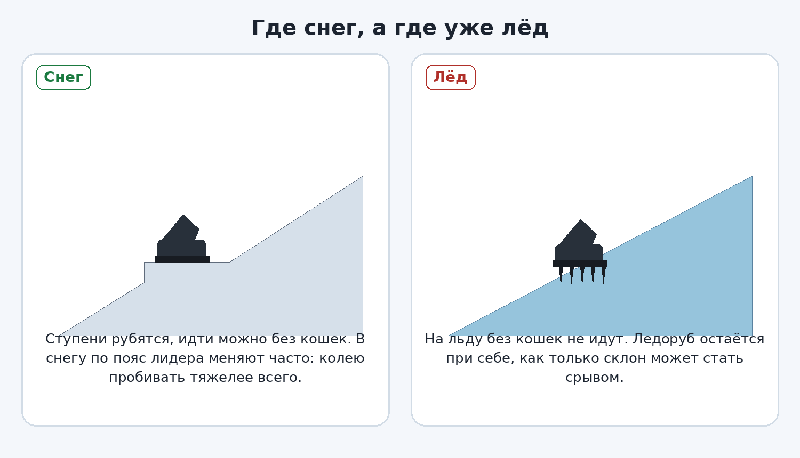

# Ледоруб и кошки

## Инструмент и его класс

Ледоруб служит опорой, самостраховкой, средством самозадержания, основой станции и инструментом для рубки ступеней. Головка состоит из клюва и лопатки: зубчатый клюв цепляется в снег и лёд, когда нужно остановить скольжение, лопаткой рубят ступени и площадки. За головку держат, когда ледоруб работает тростью. Древко бывает прямым или слегка изогнутым, его вбивают в снег, а внизу сидит заострённый штычок. Темляк — петля на кисть или на обвязку, чтобы инструмент не ушёл при срыве. Длина классического ледоруба для ходьбы — примерно до лодыжки, если держать его за головку в опущенной руке, а современные технические инструменты короче, пятьдесят — шестьдесят сантиметров. Инструктор смотрит, достаёт ли темляк до кисти и не висит ли ледоруб так, что первый же кульбит выбьет его из руки.

Ледорубы сертифицируют по европейскому стандарту EN 13089. Тип один, с маркировкой латинской «B», — базовый: он для походов и простых восхождений. Тип два, с маркировкой «T», — технический: древко и клюв выдерживают большую нагрузку, и только такой ледоруб годится для станций и страховки. Кошки проверяют по стандарту EN 893, а то, к какому ботинку они подходят, описывает распространённая классификация производителей. Ремённые кошки C1 крепятся ремнями к ботинку класса B1, полуавтоматы C2 — ремнём спереди и скобой сзади и требуют заднего ранта ботинка B2. Автоматы C3 держатся скобами спереди и сзади, поэтому им нужен жёсткий ботинок с передним и задним рантом класса B3. Инструктор сверяет класс кошек с классом ботинка до выхода. Ошибка — поставить длинный базовый ледоруб «B» в станцию только потому, что им удобно идти, или надеть автомат на мягкий ботинок: на склоне такие кошки слетают.

## Кошки на своём ботинке

У альпинистских кошек десять — двенадцать зубьев, из них два передних направлены вперёд. Антиподлипы — пластиковые пластины под стопой. Они не дают мокрому снегу налипнуть комом, а такой ком превращает кошки в лыжи и заканчивается срывом. Шарнирная рама удобна для ходьбы, жёсткая — для крутого льда, где стопа не должна складываться. Кошки подгоняют к своим ботинкам заранее, дома, а не на леднике: они не должны болтаться и сползать, ремни подрезают, концы убирают, чтобы на них не наступить. Инструктор проверяет подгонку у каждого клиента до выхода и смотрит, не торчит ли ремень под соседней кошкой. Ледоступы, резиновые накладки с мелкими шипами, к этому снаряжению не относятся: они годятся для троп и наледи, а склон их не держит. Ошибка — впервые затягивать непригнанные кошки уже на фирне, когда пальцы замёрзли и скоба села криво.

## Снег, глубокий снег и лёд

Снегом здесь называют склон, на котором ещё рубят ступени и по которому можно идти без кошек. По льду без кошек не идут: зубья на этом склоне уже не запас, а единственное сцепление подошвы. Граница проходит не по названию на карте, а по тому, держит ли рант ботинка ступень и не уезжает ли нога, когда на неё переносят вес. Инструктор смотрит на поверхность под первым шагом группы и переводит людей на кошки раньше, чем кто-то начнёт сползать на том, что ещё называют снегом. Ошибка — оставить кошки на рюкзаке, когда ступень под рантом уже не держится.

В снегу по пояс пробивать колею — самая тяжёлая работа дня. Лидер продавливает снег всем весом, вытаскивает ногу и ставит её снова, и этот темп нельзя держать долго, поэтому лидера меняют часто, не дожидаясь, пока первый выдохнется и начнёт путать направление. На простом гребне палки берегут колени: ими отталкиваются и держат ритм там, где склон ещё не обещает срыва. Ледоруб при этом остаётся при себе. Как только склон может стать срывом, палки убирают, а ледоруб берут в руку со стороны склона, потому что палкой скольжение не остановить. Инструктор смотрит, не ушёл ли ледоруб на рюкзак на гребне, который на карте ещё числится простым. Ошибка — оставить палки в руках на фирне, где уже нужна позиция для самозадержания, и менять лидера только тогда, когда колея стала кривой от усталости.

## Ледоруб в руке и ход по снегу

Положение ледоруба выбирают по тому, как быстро из него нужно перейти к торможению. В положении «трость» его берут за головку, клювом назад, и на каждом шаге втыкают штычок в снег: это опора и мгновенная самостраховка. В положении «на изготовку» ледоруб держат поперёк тела, одна рука на головке клювом к склону, другая у штычка, и из этого положения самозадержание начинается быстрее всего. Ледоруб при этом в руке со стороны склона, потому что при срыве клюв вонзают выше себя. На серпантине его перехватывают в другую руку, стоя устойчиво на ступени, а не на ходу. Инструктор смотрит на руку после каждого поворота галса. Ошибка — нести ледоруб в нижней руке, потому что так удобнее: при срыве клюв оказывается в стороне от склона.

По неглубокому снегу и фирну крутизной до двадцати градусов идут прямо вверх, ставя ноги ёлочкой, носками врозь, и опираясь на ледоруб как на трость. Так записан ответ в банке аттестации: на пологом снегу ступени и серпантин только тратят силы. От двадцати до тридцати пяти градусов поднимаются серпантином, выбивая ступени рантом ботинка, а ледоруб держат в верхней руке. Ещё круче идут в лоб, лицом к склону, выбивая ступени носком, и вбивают ледоруб древком перед каждым шагом: сначала ледоруб, потом шаг. Первый делает ступени для всей группы, и ширина его шага должна подходить самому невысокому клиенту. Инструктор смотрит, не заложил ли высокий первый ступень, на которую короткий клиент уже не встанет без прыжка. Ошибка — серпантинить там, где склон ещё держит ёлочку, и выдыхать группу на простом подъёме.

Спуск по снежному или фирновому склону малой крутизны проходят спиной к склону, выбивая ступени пяткой, с мягкими, чуть согнутыми коленями и корпусом над стопой. Откинутый назад корпус на этом спуске снимает вес с пятки, и нога уезжает. Это положение тоже записано в банке аттестации. На крутом склоне поворачиваются лицом к склону, выбивают ступени носком и вбивают ледоруб ниже на каждом шаге. На траверсе ступени выбивают рантом, верхней ногой, а ледоруб держат со стороны склона. Глиссирование, скольжение на ногах, экономит время только на знакомом склоне с безопасным выкатом внизу, без трещин, камней и обрыва. В кошках его не делают: зубья цепляют снег, и человек кувыркается.

## Самозадержание

Самозадержание останавливает скольжение ледорубом, и начинать его нужно сразу: через несколько секунд скорость уже не погасить. Ледоруб берут обеими руками, одна на головке, другая у штычка, и переворачиваются на живот ногами вниз по склону. Клюв вонзают в снег у плеча, древко кладут наискосок под грудь, штычок оказывается у противоположного бедра. На ледоруб давят всей тяжестью тела и приподнимают корпус, чтобы клюв врезался глубже. Если на ногах кошки, ноги сгибают в коленях и поднимают, чтобы зубья не зацепились за склон: иначе человека перевернёт через голову. Без кошек носки ботинок вбивают в снег, а ноги разводят шире. На ледовом склоне в кошках порядок тот же: на живот ногами вниз, клюв в лёд, вес тела на ледоруб, ноги согнуты. Инструктор смотрит, не остались ли ноги прямыми в кошках, потому что прямая нога цепляет склон и переворачивает тело.

Вход в это положение зависит от того, куда смотрит голова в момент срыва. На спине ногами вниз поворачиваются в сторону клюва, а не штычка, и сразу ложатся на живот. Головой вниз на животе клюв вонзают в снег сбоку от себя: он становится осью, вокруг которой ноги разворачиваются вниз, и только потом занимают обычную позицию. На спине головой вниз клюв вонзают сбоку у бедра и перекатываются на живот, разворачивая ноги. Если ледоруба нет или его выбило, на некрутом фирновом склоне переворачиваются на живот ногами вниз и тормозят руками и носками ботинок, поднимая корпус. На спине и головой вниз так не остановиться: упереться не во что. Инструктор отрабатывает с клиентом эти входы заранее, на безопасном выкате, потому что в срыве выбирать положение уже некогда.

## Французская техника и передние зубья

Постановка ног на льду следует крутизне. По некрутому ледовому склону, до двадцати пяти градусов, поднимаются прямо вверх на всех зубьях, разворачивая стопы ёлочкой. Дальше, примерно до сорока пяти градусов, идут серпантином: стопу ставят поперёк склона и сгибают голеностоп, чтобы в лёд вошли все нижние зубья. Круче сорока пяти градусов переходят на передние зубья. Спуск в кошках по ледовому склону средней крутизны, до тридцати градусов, проходят лицом вниз. Ноги ставят носками вниз на все зубья короткими акцентированными ударами от колена, колени согнуты, ледоруб на изготовку штычком к склону. Бег, прыжок и опора только на задние зубья на этом спуске срывают полный контакт со льдом. Инструктор смотрит, вошли ли в лёд все нижние зубья, а не два-три на ребре стопы.

Французская техника — движение всей подошвой, когда в лёд входят все нижние зубья. Она экономит силы, но требует гибкого голеностопа и уверенности: стопа на ребре оставляет в льду два-три зуба, и этого мало. Фронтальная техника — движение на передних зубьях лицом к склону, с пяткой ниже носка, чтобы работали и вторые зубья. Она годится для любой крутизны и быстро забивает икры. Комбинированная постановка смешивает их: одна нога стоит фронтально, другая всей стопой. Ледоруб на льду работает опорой, клювом выше головы или штычком сбоку, а на коротком участке для неуверенных клиентов инструктор может прорубить ступени лопаткой. Ошибка — держать фронтальную технику на пологом льду, где посадка на все зубья уже держит и бережёт ноги.

Зуб кошки цепляет штанину или гамашу соседней ноги, и человек падает, поэтому шаг делают чуть шире обычного. Снег, налипший под стопой, сбивают ударом ледоруба по ботинку, иначе ком работает как подошва без зубьев. На твёрдом льду самозадержание почти не срабатывает: скорость нарастает за секунды, и клюв не забирает её так, как на снегу. Задача на ледовом склоне поэтому в том, чтобы не сорваться. К страховке и перилам переходят заранее, а клиентов на лёд без них не выпускают. Инструктор смотрит на налипший снег и на ширину шага раньше, чем на ровность следа.

Этот текст даёт теорию ледоруба и кошек: самозадержание и работу на кошках отрабатывают только очно, и чтение не является допуском и не заменяет аттестацию.
