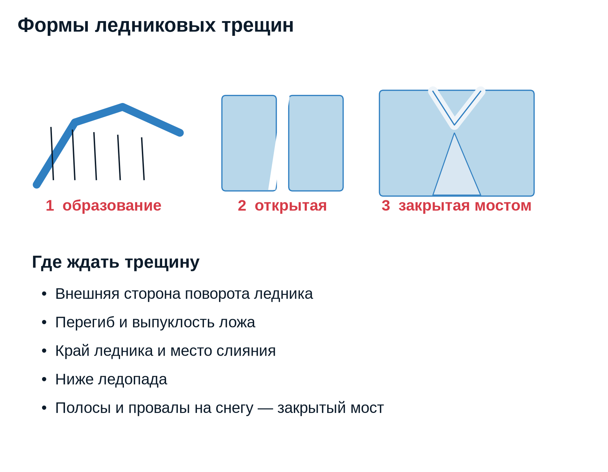

# Связка на закрытом леднике

## Что закрывает трещину

Трещины рождаются там, где лёд растягивается: на перегибах ложа, у краёв ледника и под ледопадами. Закрытым называют ледник, покрытый снегом, под которым эти трещины прячутся, и сверху видно немного. Открытая трещина часто продолжается под снегом, и её линию мысленно продлевают дальше видимого края. На снегу её выдают ложбины и прогибы поперёк пути, полосы другого цвета или другого блеска. В косом утреннем свете эти признаки заметнее, а днём, при плоском свете и в облаке, они почти пропадают. Ни один из признаков не гарантирует, что снег под ногой сплошной. Поэтому по закрытому леднику ходят только в связке, всегда, в том числе по натоптанной тропе. Падение в трещину без верёвки почти всегда смертельно, а в правильно собранной связке оно остаётся тяжёлым, но управляемым эпизодом.

Открытый ледник — голый лёд, обычно ниже снеговой линии. Трещины на нём видны, идут в кошках, с ледорубом в руке, обходят щели и часто обходятся без связки. Закрытый лежит под снегом, чаще выше снеговой линии, и трещины на нём спрятаны. Связываются заранее, на открытом льду или на морене, до того как ступить на снег. Ждать первого провала, чтобы «тогда уже связаться», поздно: человек уже в трещине, а верёвка ещё в рюкзаке. Инструктор смотрит на границу снега и останавливает группу на морене, даже если впереди видна чужая вчерашняя тропа. Ошибка — пройти несвязанными «на минутку» короткий снежный участок. Именно на таких кусках и случаются падения в трещину.

## Интервал, тормозные узлы и кто идёт первым

Между людьми оставляют столько верёвки, чтобы двое не встали на один мост и чтобы сорвавшийся не пролетел глубоко. В связке-двойке, например инструктор и клиент на верёвке пятьдесят метров, между ними оставляют двенадцать — пятнадцать метров. Так записан ответ в банке аттестации. В тройке и в более длинной связке интервал от восьми до двенадцати метров. Оставшуюся верёвку крайние несут в рюкзаке или бухтой: это запас для спасработ, и без него полиспаст не собрать. Слишком короткий интервал сажает двоих на один мост, слишком длинный даёт провис и глубокое падение. Инструктор отмеряет пролёт до выхода на снег, а не на ходу, когда верёвка уже запуталась в кошках. Ошибка — связаться на три метра «чтобы держать клиентов ближе» или вытравить почти всю пятидесятиметровую верёвку между двоими.

Тормозные узлы вяжут в средней части пролёта, например альпийской бабочкой, через полтора — два метра. У двойки таких узлов три — пять. Когда человек проваливается, узел врезается в снежную кромку трещины и гасит рывок, помогая удержать падение. Это особенно важно, когда лёгкий клиент страхует тяжёлого инструктора: испытания немецкого альпинистского союза показали, что без узлов такого партнёра на твёрдом снегу удержать почти невозможно. Если лёгкий страхует тяжёлого, узлов ставят больше. Плата известна заранее: узлы мешают при вытаскивании, и схватывающий узел приходится переносить через них. Инструктор смотрит, лежат ли узлы в средней части пролёта, а не у самой обвязки, где кромка их не поймает. Ошибка — выйти на закрытый ледник гладкой верёвкой между лёгким и тяжёлым и надеяться, что руки удержат рывок.

Каждый привязывается к верёвке узлом в точку крепления беседки. На верёвку заранее надевают два схватывающих узла, один под станцию и один под выход, и каждый несёт блок, карабины, ледобур и петли. С тяжёлым рюкзаком при падении человека переворачивает, поэтому рюкзак затягивают и учат клиента сбрасывать его уже в трещине, повесив на верёвку. Первым идёт инструктор: он ищет путь, прощупывает снег и чаще всего проваливается сам, а клиенты держат верёвку натянутой. Две связки или связка из трёх-четырёх человек удерживают и вытаскивают заметно легче, чем пара. Двойка «инструктор и один клиент» — самый уязвимый состав, и к ней готовятся тщательнее: узлы, запас верёвки, понятное клиенту одно действие на случай, если провалится сам инструктор. Инструктор смотрит, надеты ли схватывающие до входа на снег. Ошибка — доставать блок и прусик из дна рюкзака уже после того, как кто-то повис.

## Как идти

Верёвка между участниками всё время натянута: каждый метр провиса — это лишний метр падения и рывок, который на кромке уже не удержать, и провис остаётся самой частой ошибкой новичков. Трещины пересекают под прямым углом. Идти вдоль трещины в одну линию значит поставить всю связку над одной щелью: провал одного тянет остальных в ту же пустоту. Идут шаг в шаг по следу первого. Сомнительный снег прощупывают лавинным щупом или древком ледоруба, прежде чем переносить на него вес. Привал делают только на прощупанном месте и связку на нём не снимают: на пятачке, который казался безопасным, люди проваливаются, отойдя на два шага. Инструктор следит за натяжением у клиентов постоянно, а не только на «подозрительном» участке. Ошибка — собраться всей группой у края, чтобы быстрее вытянуть того, кто провалился по бедро: край не рассчитан на толпу, а верёвка в этот момент теряет натяг.

## Мост, час дня и белая мгла

Снежный мост — снег, перекрывающий трещину, и его прочность держится на ночном морозе. После ясной морозной ночи мост смерзается и держит лучше, поэтому ледник проходят рано утром. К обеду снег раскисает, и мосты, по которым утром прошли спокойно, проседают и проваливаются. Если ночь была тёплой и мороза не было, мосты не схватились уже с утра, и это повод отложить выход или выбрать другой путь. Сомнительный мост проходят по одному, со страховкой через вбитый ледоруб или через станцию, поперёк трещины, плавно, без прыжка. Очень тонкий мост проползают, распределяя вес, или обходят. Возвращаться по леднику днём часто опаснее, чем подниматься утром: тот же след уже лежит на раскисшем снегу. Инструктор назначает контрольное время разворота до входа на лёд и не отменяет его на ходу, когда до перевала «совсем немного».

Белая мгла — облако или туман, которые сливаются со снегом, так что пропадают и горизонт, и рельеф. Признаки трещин в ней не видны совсем. К ней готовятся, пока видно: записывают утренний трек в навигаторе, ставят вешки на пути подъёма, знают азимут обратного пути. В мгле связка идёт строго по своему следу или по треку, медленно, с прощупыванием. В ледопад и среди сераков без видимости не заходят. Если к тому же мосты раскисли, чаще останавливаются в безопасном месте или возвращаются по своему следу. Решение повернуть принимают по контрольному времени, а не на краю трещины, где уже не из чего выбирать. Инструктор смотрит на видимость и на снег под стопой вместе: одно только «компас есть» новый путь в мгле не делает безопасным.

Этот текст даёт теорию движения по закрытому леднику: связку отрабатывают только очно, и чтение не является допуском и не заменяет аттестацию.
