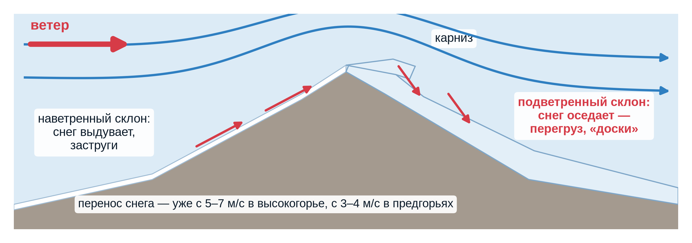
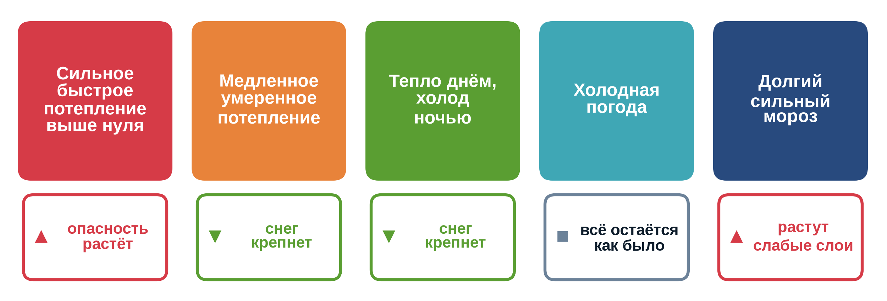
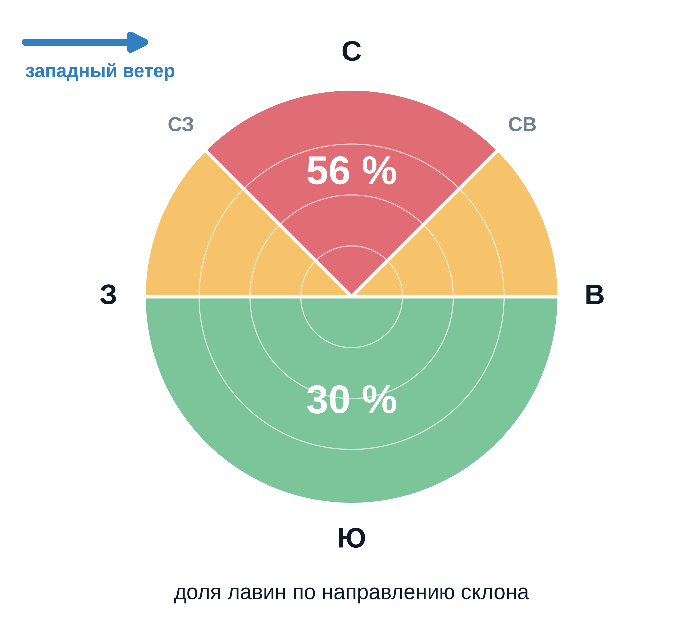
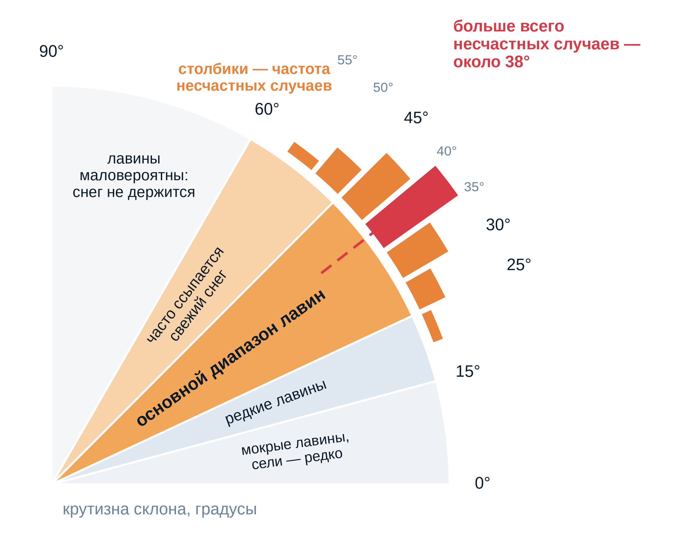
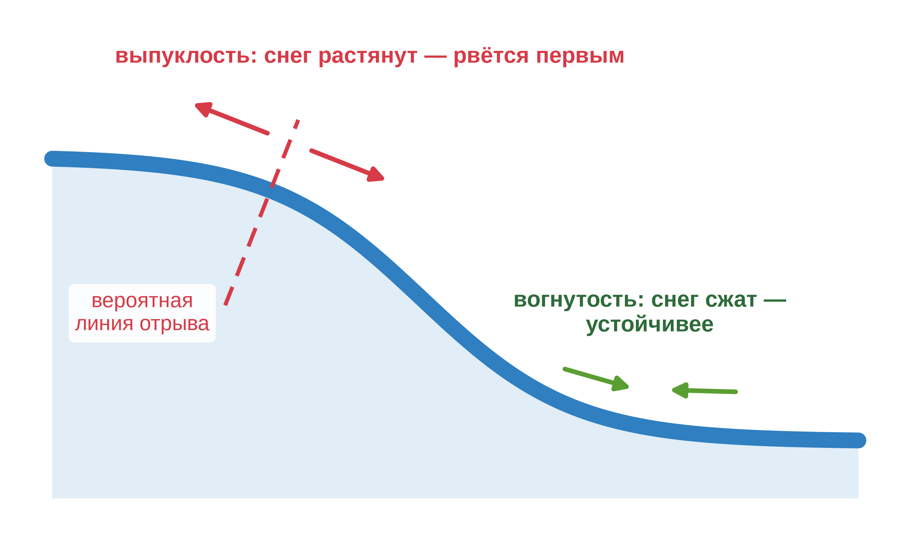
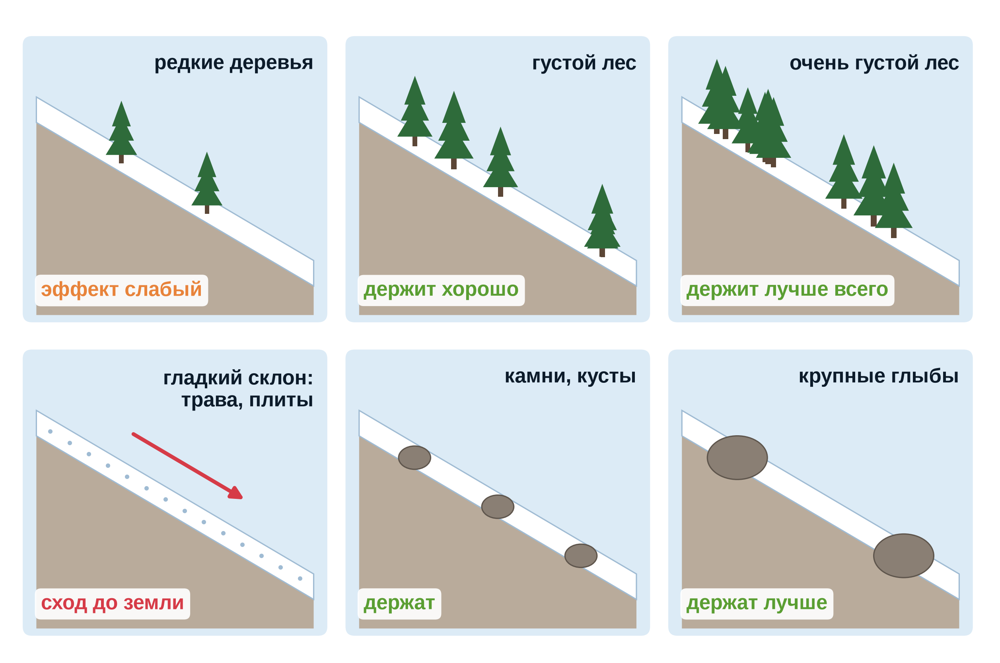

# Погода и рельеф

## Снегопад: количество и скорость

Лавинная опасность складывается из снега, погоды, рельефа и действий людей. Свежий снег — это новая нагрузка на те слои, которые уже лежат на склоне. Если за сутки выпало больше тридцати сантиметров, вероятность схода заметно растёт. Важна и скорость, с которой эта нагрузка приходит. Критической считают интенсивность от полутора до двух сантиметров в час. Двадцать сантиметров, выпавшие за несколько часов, бывают опаснее метра снега, который шёл равномерно трое суток: при медленном снегопаде зёрна успевают схватываться, а при быстром новый пласт ложится на ещё не связанный. Инструктор спрашивает не только «сколько выпало за ночь», но и «за сколько часов». Короткий интенсивный заряд при ветре перегружает склон раньше, чем это видно по сугробу у палатки.

## Ветер, надув и карниз

Ветер переносит огромные массы снега через хребет. С наветренной стороны снег выдувается, с подветренной оседает и копится, поэтому после небольшого снегопада подветренный склон может оказаться перегруженным. Следы переноса читаются на месте: карнизы, заструги, сугробы, снежные флаги на гребнях. В высоких горах сильный перенос начинается уже при ветре от пяти до семи метров в секунду, в предгорьях — от трёх до четырёх. Чем выше зона, тем сильнее снегопады, ветер и солнце и тем сложнее рельеф, поэтому самая высокая лавинная опасность обычно в высокогорной, альпийской зоне. Инструктор смотрит, куда дул ветер последние сутки, и считает подветренную сторону загруженной, даже если утром в долине снега казалось мало.

Карниз — прямое доказательство того же переноса. Ветер перевалил снег через гребень и навесил его над склоном, значит, склон под карнизом, скорее всего, перегружен. Сам карниз может обрушиться под весом человека или под собственным весом, в оттепель, после снегопада, в любое время суток. Тот, кто стоял на карнизе, падает вместе с ним. Обвал карниза часто спускает лавину на тех, кто ниже, в том числе на пологое место, которое без карниза выглядело бы безопасным. По гребню с карнизом идут с запасом от линии возможного отрыва, а под карнизами не останавливаются и не собирают группу.

## Температура, солнце и дождь

Температура меняет снег по нескольким типичным сценариям, и они действуют в разные стороны. Сильное и быстрое потепление с переходом через ноль резко повышает опасность: вода появляется в покрове, сцепление падает, а вес растёт. Медленное потепление без перехода через ноль, а также тепло днём и холод ночью, наоборот, дают снегу осесть и связаться. Холодная погода консервирует ту ситуацию, которая уже сложилась: ни лучше, ни хуже, пока не придёт новая нагрузка. Долгий сильный мороз приводит к образованию слабых слоёв внутри толщи. Весной, когда солнце прогревает снег выше нуля, обстановка на освещённом склоне может измениться за десятки минут, и утреннее решение к полудню уже описывает другой снег. Дождь нагружает склон водой и ослабляет связи между зёрнами, поэтому дождь на снегу считают тревожным сигналом в любое время сезона.

## Пять проблем, которые называют службы

Лавинные службы описывают обстановку не только ступенью опасности, но и типичной проблемой. Европейская ассоциация лавинных служб выделяет пять таких проблем, и тактика у каждой своя. Свежий снег — проблема сразу после сильного, особенно быстрого снегопада. Такой снег обычно связывается за день-два, если новой нагрузки нет, и выжидание здесь имеет смысл.

Ветровой, или метелевый, снег — свежие надувы и доски на подветренных склонах, у гребней и в кулуарах. Их часто видно по форме поверхности, и инструктор обходит именно эти формы, а не «весь снег вообще». Старый снег, устойчивые слабые слои, — самая коварная проблема. Слой из инея или огранённых кристаллов лежит глубоко в толще неделями, и доска срывается от человека спустя долгое время после снегопада. Здесь выжидание само по себе склон не лечит, и надёжный ход — обходить крутые склоны.

Мокрый снег — это прогрев или дождь, которые насыщают покров водой. Опасность растёт в тёплые часы и на тех экспозициях, куда светит солнце, и день планируют так, чтобы крутой мокрый склон остался позади до пика прогрева. Скользящий снег — весь покров медленно ползёт по траве или плитам и может сойти в любое время суток, потому что его держит уже не мороз внутри толщи, а трение о гладкий грунт. Трещины скольжения на таком склоне означают, что процесс идёт, и час суток его не отменяет. Проблема в бюллетене подсказывает, какой вопрос задавать на месте: ждать связи свежего снега, обходить надувы, отказаться от крутых склонов из-за старого слабого слоя, уйти до тепла или обойти склон с трещинами скольжения.

## Куда смотрит склон

Экспозиция — это сторона света, куда смотрит склон. Её оценивают двумя вопросами: освещает ли склон солнце и лежит ли он на наветренной или подветренной стороне от последнего ветра. Зимой при прочих равных самые комфортные склоны южные, весной и летом — северные, потому что зимой солнце укрепляет южный снег, а весной и летом оно же переводит его в мокрый. В горах умеренного пояса Северного полушария, на Кавказе, в Альпах, на Тянь-Шане, зимой опаснее всего северо-восточные и восточные склоны. Там преобладают западные ветра, и снег копится с подветренной стороны.

В банке аттестации на вопрос, склоны какой экспозиции наименее лавиноопасны, засчитывают ответ «западной». Логика ответа та же: при западных ветрах западные склоны наветренные, и снег с них сдувает. Это упрощение. В каждом районе свои ветра, свою роль играет солнце и сезон, и лавины сходят на склонах любой экспозиции. На аттестации выбирают «западной», а на маршруте читают бюллетень и следы ветра на гребне.

## Крутизна, перегиб и то, что лежит под снегом

Крутизна — один из главных факторов схода доски. Большинство досок сходит на склонах от двадцати пяти до шестидесяти градусов. Больше всего несчастных случаев приходится на тридцать пять — сорок градусов, с пиком около тридцати восьми: на таком угле снег уже способен поехать и при этом ещё успевает накопиться. На очень крутых склонах снег регулярно ссыпается и не набирает толстую доску, на пологих сдвиг слабее и покров устойчивее, но сходы бывают и там, и там. Смотрят не только на угол под ногами. Лавину можно запустить с пологого места внизу, а оторвётся пласт выше и приедет на группу. Склон в тридцать градусов над обрывом или кулуаром опаснее склона в тридцать восемь с чистым выкатом, потому что последствия срыва задаёт то, что лежит ниже.

Снег на склоне медленно ползёт и по-разному сидит на форме рельефа. На выпуклостях и перегибах он растянут, связь ослаблена, и линия отрыва доски чаще проходит именно по выпуклости. Во впадинах снег сжат и держится лучше, но впадина же принимает чужой снег, если он сорвался выше. Такие места напряжения привязаны к рельефу, их видно заранее, и линию ведут в обход перегиба. Отдельные камни и кусты тоже создают точки, от которых при нагрузке может стартовать доска: вокруг них покров тянется и рвётся раньше, чем на ровном поле.

Имеет значение и основание, на которое лёг снег. Гладкие скальные плиты, трава и заросли рододендрона провоцируют сход на всю толщину, до самой земли, потому что покров скользит по ним целиком. Камни, кусты и уступы работают как якоря и держат снег. Редкие деревья почти не помогают, густой лес держит лучше всего. Следы прошлых лавин читаются внизу склона: поломанный лес, деревья, наклонённые вниз по ходу, наледь на стволах со стороны горы. Такой лес означает, что это место уже было зоной отложения, и маршрут уводят в сторону. Прочитанное остаётся теорией и не даёт допуска: снег, ветер и форму склона оценивают на месте.
