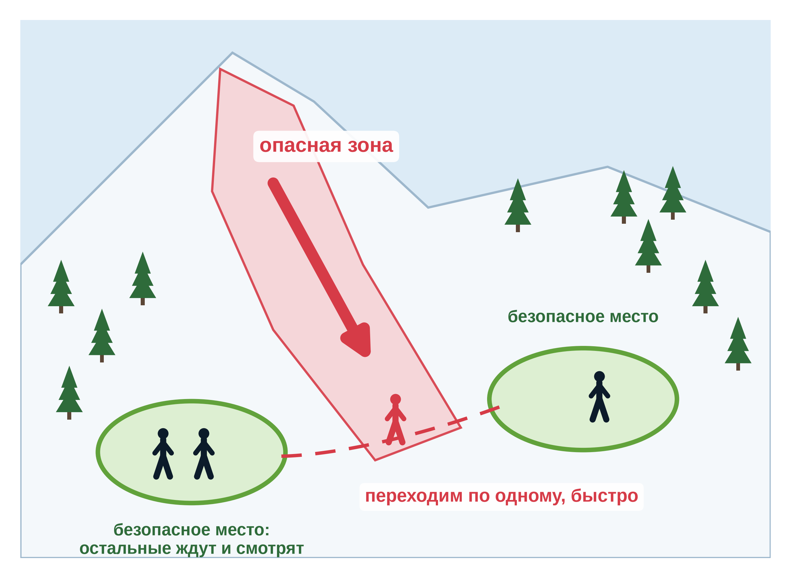
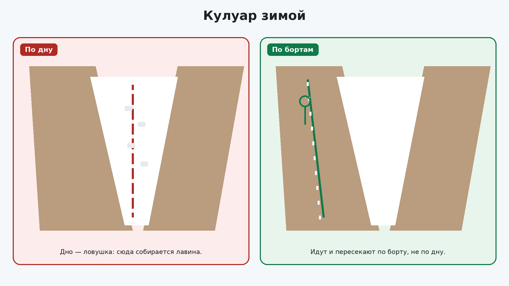
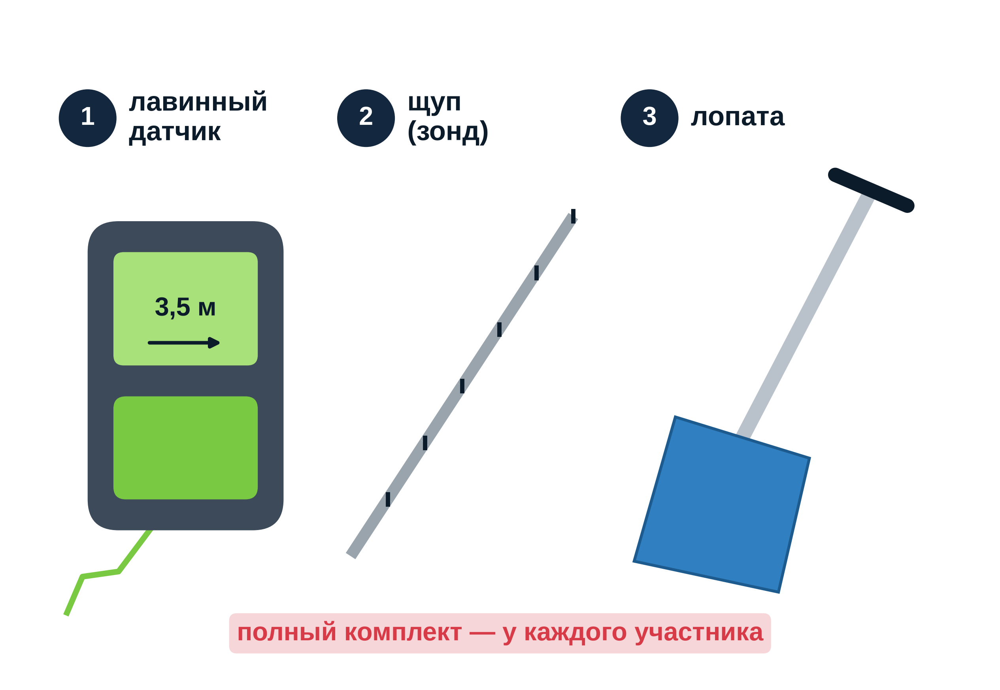
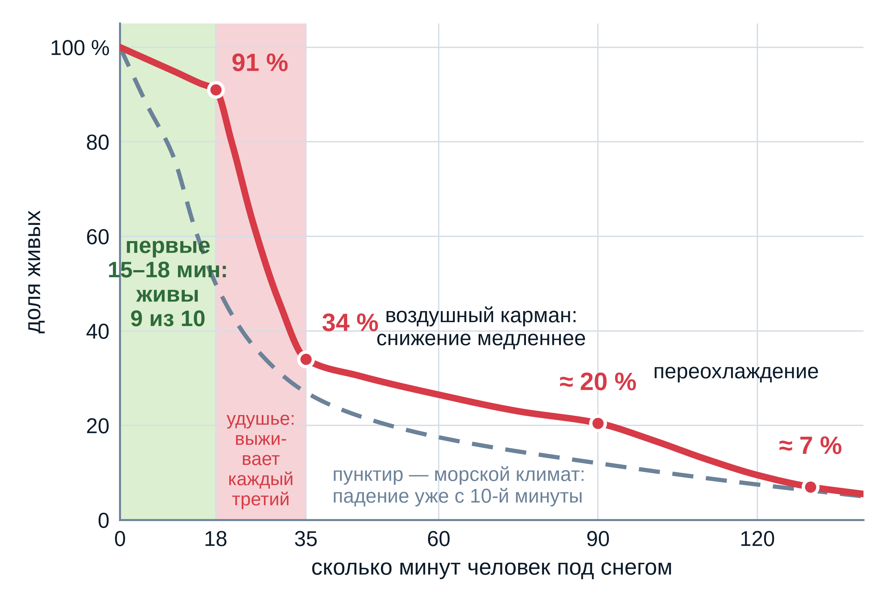

# На лавиноопасном маршруте

## Ступень опасности и откуда берётся бюллетень

Лавинный бюллетень — прогноз опасности для района по пятиступенчатой шкале, которую приняла Европейская ассоциация лавинных служб. Первая ступень, низкая, означает, что сход возможен на отдельных очень крутых склонах. Вторая, умеренная, требует осторожности на крутых склонах тех экспозиций и высот, которые бюллетень называет прямо. Третья, значительная, самая коварная: снег уже неустойчив, а признаки на глаз не всегда очевидны, и на эту ступень приходится большинство несчастных случаев. Четвёртая и пятая, высокая и очень высокая, означают, что лавины сходят сами, и лавинный рельеф обходят полностью. Бюллетень говорит о районе в целом. На конкретном склоне решение принимает руководитель по тому, что видит сам.

В современном бюллетене есть ступень, часто разная выше и ниже определённой высоты, главная из пяти проблем снега, роза экспозиций и высот и тенденция на завтра, растёт опасность или снижается. В Альпах службы публикуют такой бюллетень ежедневно, в США и Канаде работают свои лавинные центры. В России единой общедоступной службы ежедневных бюллетеней нет. Региональные управления Росгидромета выпускают предупреждения, в Хибинах работает лавинная служба, на крупных горнолыжных курортах Кавказа — свои службы, и эти сообщения вместе со сводками МЧС смотрят перед выходом. Там, где бюллетеня нет, а это большинство районов походов и восхождений, инструктор назначает ступень сам по снегопаду, ветру, температуре и признакам на склоне.

## Как ступень превращают в решение

Швейцарский горный гид Вернер Мунтер предложил метод сокращения риска, его же называют методом редукции. Каждой ступени присваивают потенциал: низкой — два, умеренной — четыре, значительной — восемь, высокой — шестнадцать. Потенциал делят на факторы сокращения. Главный фактор — крутизна самого крутого участка пути: чем он положе, тем больше делитель, от двух до четырёх. Дальше идут отказ от самых опасных экспозиций, например от северного сектора, и дисциплина группы: дистанции и маленькая группа. Если после деления остаток не больше единицы, риск считают приемлемым. При значительной опасности, потенциале восемь, участок положе тридцати градусов делит на четыре и оставляет два, а обход северных склонов делит ещё на два и оставляет единицу.

Метод дополняет фильтр «три на три». Условия, рельеф и людей проверяют трижды: дома, по пути в районе и на самом склоне. Дома смотрят бюллетень или свою оценку по снегопаду и ветру, карту крутизны, ловушки рельефа — обрыв, кулуар, русло под склоном — и заранее назначают точки, где группу разворачивают по времени. В районе оценку обновляют по свежему переносу, звуку «вумпф» и сходам на той же экспозиции. На самом склоне решение принимают заново: угол под ногами, угол выше и то, чем кончится выкат. Сомнение на третьей проверке означает, что на этот склон не выходят.

## Признаки, которые меняют план

Красные флаги — явные признаки, что план склона пора менять. К ним относят естественный сход на соседних склонах, трещины в покрове, звук «вумпф» и просадки, переход температуры через ноль, дождь, резкие перепады температуры, сильный ветровой перенос, сильный снегопад за последние сутки, плохой лавинный прогноз и плохие результаты снежных тестов. Один или два таких признака уже требуют повышенной осторожности и, возможно, другого пути. Длительная ясная безветренная погода к индикаторам лавинной опасности не относится, и на аттестации правильным считают именно этот ответ. Оговорка для маршрута другая. В долгий мороз и ясные ночи на поверхности растёт иней, и после следующего снегопада он станет слабым слоем, по которому уйдёт доска.

Два признака говорят о неустойчивости прямо, без расчёта потенциала. «Вумпф» — глухой звук, с которым покров оседает под ногами: слабый слой разрушается в этот момент. Трещина, которая бежит от ботинок или лыж, показывает, что доска напряжена и готова оторваться. Услышав такой звук или увидев такую трещину, дальше по крутому склону не идут. Возвращаются по своим следам в безопасную зону и меняют план дня. Свежий сход на соседней экспозиции читают так же: тот снег уже показал, что держать собственный вес он не может.

## Как идут по склону

Самый надёжный способ не попасть в лавину — не выходить на нестабильный снежный склон. Если пересечь склон всё же нужно, готовятся до первого шага. Руки вынимают из темляков палок, а поясной ремень обычного рюкзака расстёгивают, чтобы при попадании в лавину быстрее сбросить и палки, и рюкзак: они тянут вниз и выворачивают руки. Датчик у всех включён на передачу. По возможности выбирают гребень или плато, потому что при сходе снег уйдёт вниз из-под группы. Спускаться по потенциально лавиноопасному склону безопаснее прямо вниз по линии стока, по одному и ближе к краю. Каждый траверс и каждый поворот зигзага подрезает пласт поперёк и нагружает его по всей ширине.

Очевидно опасный участок проходят по одному, от одной безопасной зоны к другой: скалы, нависание, гребень, остров устойчивости. Пока один идёт, остальные стоят вне линии выноса и следят за ним. Останавливаются только в таком месте, а не посреди склона. Перед выходом на склон проверяют датчики: включены, режим передачи, кто проверяет и с какого расстояния. Клиентам коротко говорят, что делать, если накрыло: выплывать, закрыть рот, поднять руку.

Место сбора назначают заранее вне зоны выноса. След на подъёме прокладывают положе тридцати градусов, по рёбрам и островам безопасности. Инструктор идёт первым и выбирает линию, замыкающий следит, чтобы никто не остановился в зоне. Типичная ошибка — собрать всю группу на выкате внизу желоба, то есть в том месте, куда снег как раз приедет.

## Кулуар, летняя тропа и шурф одного утра

Кулуар — естественный лавинный жёлоб. Снег, сорвавшийся в любой точке на бортах, по линии стока сбегает на дно и по дороге захватывает то, что уже лежит в лотке. На дне поток глубже, чем на борту, а стены с обеих сторон не оставляют шага в сторону. Поэтому кулуар проходят и пересекают по бортам и рёбрам. Инструктор выбирает ребро, потому что снег из-под ног уходит вниз и в сторону от группы, а рядом есть скала, на которую можно шагнуть. Дно оставляют линии стока.

Летняя тропа, которая серпантином поднимается по этому дну, зимой становится другим маршрутом. Под снегом у неё другая крутизна: ступени и внутренние углы засыпаны, и нога стоит уже на угле снежного склона, часто более гладком и более крутом, чем каменная тропа. Ловушки тоже другие. Обрыв, яма над ручьём и сами стены кулуара либо спрятаны под снегом, либо только что образованы им.

Один шурф описывает одну точку и один час. Пока группа поднимается, южная стена переходит через ноль, карниз прогревается, ветер докладывает надув на подветренный борт, и склон, который утром держал колонну, к полудню готов дать доску. Утренний тест не лицензирует вторую половину дня. Инструктор возвращается к решению на месте: крутизна под ногами и выше, свежие трещины, звук просадки, сходы на той же экспозиции, то, что лежит на выкате. Если эти признаки разошлись с утренней ямой, линия уходит на ребро или день разворачивают. Чужой след по дну кулуара такого решения не заменяет: его оставила другая группа в другой час.

## Датчик, электроника и лавинный рюкзак

Минимальный набор на лавиноопасном склоне — лавинный датчик, зонд, то есть лавинный щуп, и лопата. Комплект нужен каждому, а не один на группу. Если у засыпанного нет датчика, а у остальных нет щупов и лопат, первые минуты уходят впустую. Лавинный рюкзак, лыжи или дыхательное устройство этот минимум не заменяют.

Все датчики мира работают на одной частоте, четыреста пятьдесят семь килогерц, поэтому приборы разных фирм видят друг друга. Современный датчик цифровой и имеет три антенны. Третья помогает в ближнем поиске, когда до засыпанного несколько метров: убирает ложные пики и точнее показывает точку над ним. Перед выходом инструктор проверяет, что датчики включены на передачу и работают.

Смартфон, рация, часы и магниты создают помехи датчику, особенно в режиме поиска. Производители советуют держать электронику не ближе двадцати сантиметров от датчика на передаче и пятидесяти сантиметров при поиске. В банке аттестации засчитывают другой ответ: постоянная работа бипера в режиме передачи ухудшает качество связи телефона. На аттестации выбирают этот вариант. На деле страдает датчик, и телефон убирают от него на те расстояния, которые называет производитель.

Цифра на экране при поиске — не расстояние по прямой. Прибор ведёт по изогнутым силовым линиям поля передатчика, и показание зависит от положения антенны засыпанного, глубины и рельефа. В банке аттестации верным считают ответ о погрешностях сигнала в снегу, связанных с рельефом и глубиной залегания, а также о воздействии магнитного поля Земли. На аттестации выбирают его. Магнитное поле Земли на сигнал этой частоты почти не влияет.

Лавинный рюкзак при рывке за ручку надувает подушку объёмом сто пятьдесят — двести литров. В движущейся лавине крупные предметы выталкивает к поверхности, и человек с раскрытой подушкой чаще остаётся сверху. Смертность при раскрытой подушке вдвое ниже. Подушку нужно успеть раскрыть, и она не защищает от ударов о камни и деревья и не спасает, если лавина остановилась в ложбине или кулуаре, где снег лежит слоем в несколько метров. Поясной и ножной ремни лавинного рюкзака застёгнуты всегда: иначе рюкзак сорвёт вместе с подушкой, и механизм не на ком работать. Совет расстегнуть пояс относится к обычному рюкзаку, и на аттестации вопрос про темляки и поясной ремень засчитывают так: их готовят, чтобы быстрее избавиться от палок и рюкзака в лавине. Лавинный рюкзак при этом остаётся застёгнутым и не заменяет датчик, щуп и лопату.

## Минуты после схода

Если человек засыпан и не получил смертельной травмы сразу, время решает почти всё. В первые пятнадцать — восемнадцать минут под снегом живы около девяти из десяти. К тридцати пяти минутам, когда главной причиной становится удушье, живы около трёх из десяти. Дальше доля живых снижается медленнее, уже из-за переохлаждения. Цифра «через двадцать минут четверо из десяти» неверна, её не даёт кривая выживания.

Спасатели со стороны за эти минуты не успевают, поэтому реальный шанс — работы силами самой группы. Сначала останавливаются и оценивают, не сойдёт ли вторичная лавина на место поиска: это главная опасность для тех, кто ищет. Затем вызывают помощь и переключают все датчики на поиск. Ищут сигнал, потом ведут грубый и точный поиск. Зондируют по спирали и после попадания оставляют щуп в снегу. Копают, начиная ниже по склону. Добравшись, первыми освобождают лицо и дыхательные пути.

Организация держится на ролях. Руководитель не копает: он держит обстановку и людей. Ищут от точки, где человека видели в последний раз, вниз по линии потока, сначала глазами и на голос. Ширину полосы поиска берут из паспорта датчика. Если засыпано несколько, найденного отмечают и ищут дальше.

Если датчика нет или он разряжен, зондируют цепью: сначала грубо, затем плотнее у найденных вещей, у конца выноса и с внешней стороны поворотов. Копают ниже по склону примерно на глубину залегания, конвейером, и меняют копающих. Повторный сход — повод остановить работы и отойти. Прочитанное остаётся теорией и не даёт допуска: поиск датчиком, зондирование и откапывание осваивают только очно.
