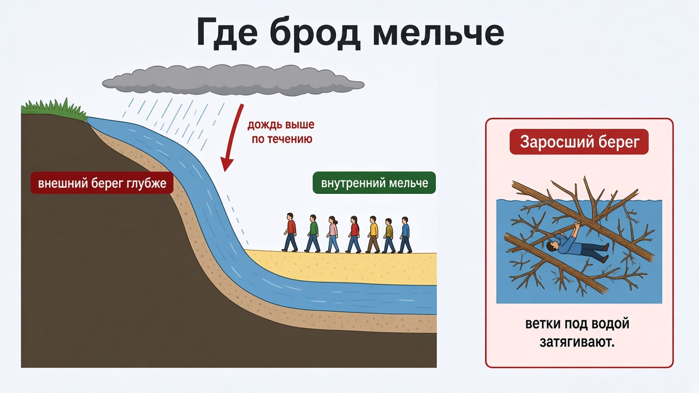
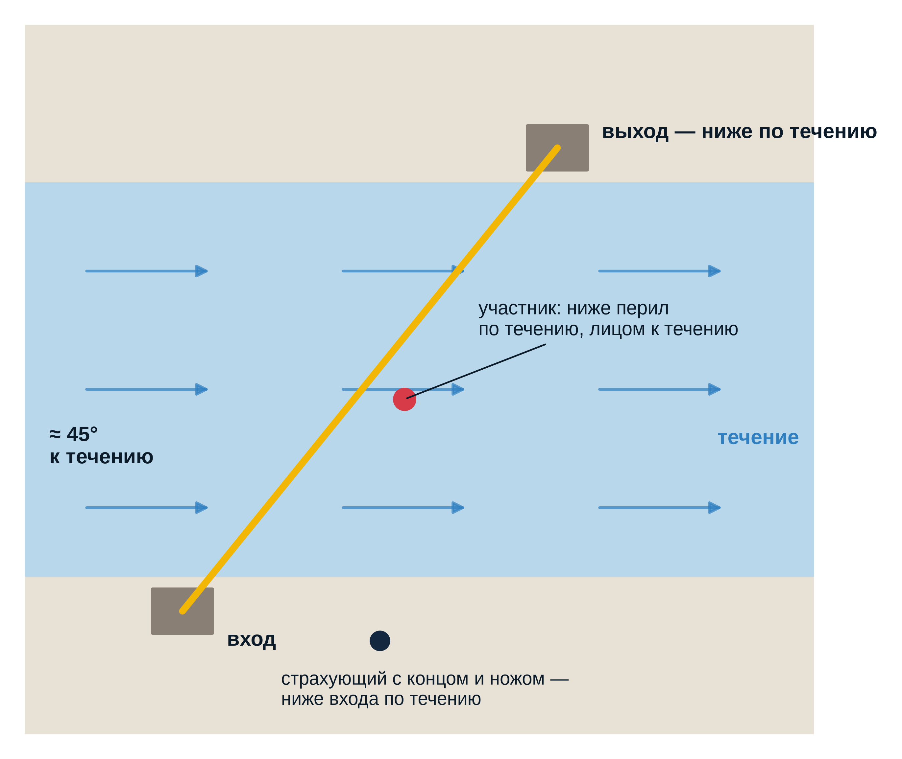

# Переправы

## Когда река поднимается во время перехода

Горная река — одна из главных опасностей похода: вода ледяная, течение сбивает с ног, и упавший за секунды оказывается ниже по течению, где берег уже другой. Реки с ледников и снежников живут по суточному ритму. Днём солнце топит лёд, уровень в верховьях максимален во второй половине дня, а в длинных долинах пик приходит к вечеру. После ночного холода воды меньше всего, поэтому переправу ставят на раннее утро, а группа, подошедшая после обеда, ночует и переходит на рассвете. Перед бродом смотрят вверх по долине. Если там всё ещё идёт дождь, волна с верховьев догоняет переход: первые застают один уровень, хвост может встретить реку уже выше.

В банке аттестации правильной температурой воды в верховьях рек с ледника считают около четырёх–пяти градусов, и на аттестации выбирают этот ответ. У самого ледника вода бывает ближе к нулю, и за несколько минут немеют ноги и пропадает координация. Брод возможен до уровня бёдер, так и засчитывают на аттестации. В быстром потоке опасно уже по колено: струя сбивает ногу раньше, чем вода доходит до пояса. Глубину поэтому читают вместе со скоростью.

## Где искать створ

Место выбирают по ширине, глубине, скорости и по точкам для перил: дереву, скале, крупному камню. Высота над уровнем моря и температура воды на выбор створа не влияют. Хороший створ — разлив на рукава или широкий перекат, галечное дно, пологий выход и ниже спокойная вода или отмель, где упавшего можно поймать. Не переправляются над завалом, порогом или водопадом. Сужение и глухой стук камней по дну означают, что поток катит валуны. Вдоль реки стоит пройти: лучший створ часто лежит в сотне метров от тропы.

Течение бьёт во внешний берег излучины, подмывает его и углубляет русло именно там. Внутренний берег мельче, на нём откладывается галька, и брод ищут вдоль него. Внешний берег, даже если по нему идёт тропа, прячет яму под обрывом. У заросшего деревьями берега под водой часто лежат ветки. Упавшего прижимает к ним и затягивает под крону, которая с берега казалась опорой. Такой берег не берут ни как выход, ни как место, куда маятником выносит человека.

Решение устроено лестницей. Вода до колена, течение умеренное, ниже спокойная вода: идут вброд стенкой, шеренгой или с шестом. По колено в быстром потоке или по бёдра в спокойной воде — только по перилам, и только если точки есть на обоих берегах. Не переправляются в мутной воде со стуком камней, если река шире верёвки, если ниже порог, водопад или завал, если люди замёрзли, а света мало. Тогда ждут утра, ищут разлив, переходят там, где река делится на рукава, или обходят её по леднику у истока. Закрытый ледник на обходе требует связки, и это время закладывают заранее. Отказ от переправы — частое правильное решение.

## Обувь, рюкзак и кто в середине

В воду входят в обуви, которая закрывает ногу от камней и держит на скользком дне. Босая стопа на гальке ранится сразу, шлёпанцы и кроксы течение снимает. Многие идут в треккинговых ботинках без носков или в отдельной жёсткой обуви для воды. Поясной и грудной ремни расстёгивают до первого шага: застёгнутый рюкзак при падении переворачивает лицом в воду, и его нужно сбросить мгновенно. Вещи и спальник лежат в гермомешках. Командует один человек, страхующего с концом ставят ниже по течению, на том берегу сразу переодеваются и греются.

Лёгкого сносит раньше: при той же глубине ему нечем прижаться ко дну. Невысокому вода по бёдра там, где высокому по колено. Тот, кто боится, на середине замирает и перестаёт переставлять ноги, а стоящий в потоке теряет опору быстрее идущего. Лёгких и слабых ставят в середину стенки, их рюкзаки несёт кто-то сильный или переправляют отдельно. На мелком месте заранее показывают стойку, хват и падение со сбросом рюкзака. У каждого страхующего на берегу есть нож.

## Стенка, шест и верёвка на человеке

Неглубокую реку без верёвки переходят группой. Стенка — три–пять человек плечом к плечу, лицом против течения, держатся за плечи или лямки и идут боком приставным шагом. Сильных ставят по краям, слабых в середину. Шеренга вытянута вдоль потока: выше по течению самый сильный и тяжёлый разбивает струю, остальные идут в затишье и держат впереди стоящего за пояс. Шаг делают, только когда все стоят, и команду даёт один. Если течение разваливает стенку, для брода без перил река уже слишком сильна.

Шест или пара палок даёт третью точку. Его упирают выше по течению, поток прижимает человека к шесту, и две ноги вместе с ним образуют треугольник. Шест ниже по течению поток отрывает, и падение начинается с потери этой точки. Встают лицом против течения или немного боком, идут приставным шагом, ноги не скрещивают, переставляют по одной опоре: шест, нога, нога. Длинный шаг и прыжок с камня теряют дно. Смотрят на противоположный берег: бегущая вода перед глазами кружит голову.

Первым идёт инструктор, налегке, в грудной обвязке и беседке, рюкзак снят. На аттестации крепление такое: к перекрестью грудной обвязки на спине — короткие транспортные усы, к ним концы страховочной и транспортной верёвок. Смысл спины в том, что если человека собьёт, верёвка сзади разворачивает его лицом вверх. Верёвка на груди или на поясе спереди даёт потоку тянуть лицом вниз. Страхующий стоит ниже по течению, и натянутая верёвка маятником выносит сбитого к своему берегу. К схеме добавляют условие, без которого она становится ловушкой: привязанный в потоке должен освободиться за секунду, через отстёжку, которая раскрывается под нагрузкой, а у страхующего в руке нож. Первый переходит с шестом и на том берегу закрепляет перила.

Когда течение сбивает привязанного, верёвка натягивается, и поток давит на тело всей силой: человека прижимает к верёвке и тянет под воду. Чем ближе верёвка к перпендикуляру к течению, тем сила больше. Карабин с муфтой и узел под нагрузкой не открыть. Петля на ноге или руке и привычка связывать людей друг с другом довершают ловушку. В воде человека не привязывают к товарищу и не обвязывают по поясу. Если верёвка к нему крепится, то только через быструю отстёжку. Перила натягивают под углом, чтобы поток сносил к выходу. Сомнение, что человек удержится на ногах, означает, что на этом месте не переправляются.

## Перила по диагонали и последний

Перила натягивают по диагонали: выход на том берегу ниже входа по течению, примерно под углом сорок пять градусов к струе. Тогда течение само несёт вдоль перил к выходу, и сила на верёвку меньше, чем на линии поперёк. Перила поднимают высоко над водой и натягивают туго, обычно полиспастом. Точки — дерево, скала, крупный камень. Участник идёт ниже перил, лицом к течению, держится руками. Страхующий стоит ниже по течению с концом и ножом. Перила, провисшие в воду, сразу перетягивают: верёвка в потоке сама становится тем, о что человека прижимает.

По схеме аттестации участник пристёгнут к перилам самостраховкой с карабином и, кроме того, страхуется инструктором. Выше перил идти нельзя: течение прижмёт к верёвке и затянет под неё. Длина самостраховки — не больше локтя от груди. Ус в полтора–два метра позволяет утащить тело вниз, и человек оказывается под водой на верёвке. На сильном течении карабин под нагрузкой не отстегнуть, поэтому отстёжку делают быстрой или идут, держась руками, со страховкой с берега. Если поток может сбить, переправу на этом створе не делают. Карабин скользит по перилам, и отстёгивают его уже на суше.

Последний остаётся без перил, которые нужно снять, и его переход продумывают заранее. Рюкзаки к этому времени уже переправлены по перилам на карабинах. Последним идёт опытный, обычно инструктор, налегке. В первом варианте перила отвязывают на исходном берегу, и он идёт со страховкой с дальнего: верёвка уходит вверх по течению под углом, и при срыве маятник выводит к берегу. Во втором перила с самого начала двойные, на сдёргивание вокруг дерева или через петлю, и после перехода их сдёргивают с дальнего берега. Страхующий с концом стоит ниже по течению. Одиночный переход без страховки в конце — классическая ошибка: самый опытный оказывается в воде один, когда организация уже кажется законченной.

## Бревно, навесная и снежный мост

Мокрое бревно скользкое, а под ним бурлит вода. Перила при переправе по бревну закрепляют на обоих берегах, натягивают и поднимают над бревном примерно на уровень груди или пояса, участник идёт к ним на самостраховке. Перила, привязанные к самому бревну, падают вместе с человеком. Перила в руках страхующих рывка не держат. Навесная переправа — верёвка высоко над рекой, по которой перемещаются на карабине или блоке, а с берега ведут сопровождающей верёвкой. Её натягивают так, чтобы провис с человеком не доходил до воды. Сильно натянутая верёвка сильно нагружает опоры. Обе схемы наводят обученные люди, и на аттестации навесную отрабатывают очно.

Участник пристёгивается блоком или двумя карабинами к системе. С одного берега его тянут вперёд, с другого держат сзади, руки лежат на своей самостраховке, а не на ролике, куда их затягивает. Рюкзак переправляют отдельно, на карабине, оттяжкой с берега, вещи в гермомешке: человек и груз вместе провисают ниже, чем пустая верёвка. Опоры при тугом натяжении смотрят до первого человека, потому что обрыв под нагрузкой роняет его в поток.

Снежный мост, остаток лавины или снежника, утром после мороза прочнее, а днём вода подмывает его снизу. Переходят по одному, со страховкой, осмотрев края и толщину. Трещины вдоль моста и провисание означают, что обрушение близко. Поток на поверхности ледника устроен жёстче: русло во льду гладкое, упавшего уносит, выбраться по стенкам невозможно. Такие потоки вброд не переходят, их обходят или перешагивают в узком месте со страховкой. Обход реки у истока по закрытому леднику — движение в связке, и время на него закладывают до того, как группа упрётся в воду.

## Если человек уже в воде

Падение считают секундами. Первое движение — сбросить рюкзак, для этого ремни были расстёгнуты. Дальше ложатся на спину ногами вперёд, держат ноги у поверхности и отталкиваются ими от камней. Вставать на быстрине нельзя: нога застревает между камнями, и течение кладёт под воду. Гребут к берегу под углом, к тихой воде.

Страхующие ниже по течению бросают конец так, чтобы он лёг перед упавшим, и вытягивают маятником. Если человек висит на перилах, голова под водой, а подтянуться он не может, его освобождают отстёжкой или ножом и ловят ниже. В воду за ним без собственной страховки не прыгают. На берегу сразу сухая одежда, тепло и горячее питьё: после ледяной воды переохлаждение развивается быстро. Прочитанное остаётся теорией и не даёт допуска: брод, навеску перил и навесную переправу осваивают только очно.
