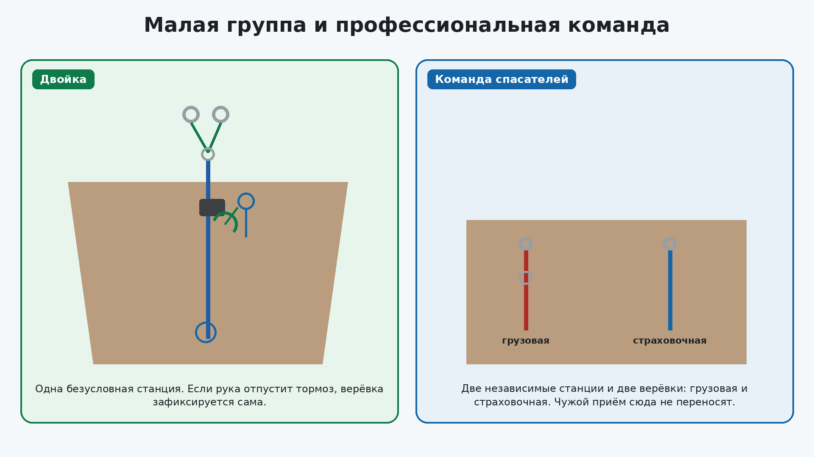

# Несчастный случай

## Первые минуты

Несчастный случай — событие с травмой или угрозой жизни участника, и первые минуты решают, не появится ли второй. Поисково-спасательные работы — поиск, помощь и эвакуация силами профессиональных спасателей, поисково-спасательного отряда МЧС или региональной службы, и для пострадавших в России это бесплатно. Самоспасение группой — та же помощь своими силами, до прибытия спасателей или вместо них. Регистрация группы — уведомление МЧС о маршруте до выхода, контрольный срок — время, к которому группа должна сообщить о себе, и молчание после срока запускает поиск на пустую гору.

Порядок первых минут гасит аварию раньше, чем начинается помощь. Сначала останавливают то, что ещё убивает: летящие камни, человека на верёвке, группу на лавинном склоне, и не создают новых пострадавших бегством вниз по осыпи или прыжком в реку без страховки. Затем очередь безопасности — своя, группы и только потом пострадавшего, а если место опасно, его сначала переносят туда, где можно стоять. Дальше идут осмотр сознания, дыхания и сильного кровотечения, первая помощь, тепло и коврик под тело. Вызов, кто передаёт, где, что случилось и сколько пострадавших, ставят как можно раньше, и только после него решают, ждать спасателей или выходить своими силами: решение без сообщения оставляет отряд на старых координатах. Осмотр и первая помощь здесь стоят в очереди, а их приёмы — в предыдущем модуле.

В аварии командует один человек, потому что несколько самых опытных одновременно бинтуют, звонят и распоряжаются, и картина распадается. Инструктор не делает всё сам: он видит целое, принимает решения и держит связь со спасателями. Один или двое постоянно с пострадавшим, согревают, наблюдают, записывают и говорят с ним, остальные ставят тент, кипятят воду, готовят площадку и ищут место, где ловит связь. Кто-то смотрит за остальными участниками: они напуганы, мёрзнут и из страха делают ошибки, из которых выходит второй случай. Никто не остаётся один и никто не уходит без разрешения. Чёткое поручение снимает панику лучше уговоров.

В стрессе пишут сразу, в блокнот или телефон: время случая и вызова, координаты, высоту, ориентиры, а состояние — сознание, дыхание, пульс, жалобы — примерно каждые пятнадцать минут. Туда же попадает, какая помощь оказана, и точное время жгута, если он наложен. Запись нужна спасателям, врачам и самому инструктору: по ней видно ухудшение и то, что было сделано и когда. Тепло не даёт замёрзнуть, а запись не даёт пропустить, что человек перестал отвечать.

## Спасатели, ожидание и самоспасение

Перед выходом в высокогорье группу регистрируют в территориальном подразделении МЧС России, в главном управлении по региону, обычно через форму на сайте: маршрут, состав, связь и контрольный срок. Ищут спасатели МЧС, поэтому регистрация идёт не в полицию и не в администрацию. Там же узнают телефон оперативного дежурного и частоту спасателей района и записывают их, а на маршруте сообщают о смене плана, иначе отряд держит вчерашний перевал. После завершения в первую очередь сообщают в то же подразделение. Забытый отзвон по истечении срока поднимает поиск, и силы, нужные кому-то другому, уходят на пустую гору.

Ожидание длится от пары часов до нескольких суток, если погода нелётная, и ждать означает работать: первая помощь, безопасность пострадавшего и всей группы, связь с МЧС. Укрытие — тент, спальник, коврик и горячее сладкое питьё, если человек в сознании и нет травмы живота. Сеансы идут по договорённости, в эфир выходят минута в минуту и говорят, изменилось ли состояние. Наблюдение и записи продолжают, площадку и сигналы готовят заранее, батареи берегут: телефон между сеансами в режиме полёта и в тепле. Упаковка вещей и репетиция встречи не главное. Пропущенный сеанс для отряда выглядит как ухудшение или как потеря группы.

Если связи нет, за помощью идут минимум двое, самые сильные и опытные, которые не станут вторыми пострадавшими на спуске, и несут записку: кто сообщает, где точно группа, что случилось, сколько пострадавших и в каком состоянии, что нужно — вертолёт, носилки, врач. Устный пересказ после многочасового спуска искажается, записка нет. Гонцы идут к ближайшей точке связи, к лагерю или к людям, остальные остаются с пострадавшим, метят место и подают сигналы. Одного не оставляют даже ненадолго. Тот же порядок, двое и записка, годится и для выхода на гребень в двадцати минутах, где может появиться сеть.

Своими силами выходят при лёгкой травме, если человек идёт сам или с помощью, если до тропы и людей близко, или если погода портится и вертолёта в ближайшие сутки не будет. Ждут при подозрении на позвоночник или таз, при бессознательном или тяжёлом состоянии и когда транспортировка опаснее ожидания, например ночью по сложному рельефу. Любое решение сообщают в МЧС, чтобы спасателей не оказалось там, где группы уже нет, и здоровыми не рискуют ради выигрыша в час. Решение пересматривают вместе с состоянием и погодой: утреннее ожидание борта к вечеру при закрытом небе становится спуском, и отряд узнаёт об этом до взлёта.

## Малая группа и чужое снаряжение

Малая группа — четыре человека или меньше, двойка — двое, и спасработы она ведёт тем альпинистским снаряжением, которое уже есть на маршруте: это и есть подручные средства. Профессиональная команда приходит с отдельным комплектом, двумя независимыми станциями и двумя разнесёнными верёвками, грузовой и страховочной. Приём одной системы нельзя молча перенести на другую. То, что у команды рассчитано на ролики и зажимы, на карабине и схватывающем узле работает иначе: груз, который держала вторая верёвка, у двойки оказывается на единственной. Инструктор смотрит, что висит на обвязках, и выбирает приём под этот набор, а не под чужой комплект.

Сначала нужна связь с пострадавшим, и если его не слышно, к нему идут, по дороге оценивая опасность для него и для себя. В камнепаде, ледопаде или под лавиной, если рельеф позволяет, его сразу стаскивают из опасной зоны: на простом месте это быстрее и бережнее, чем поднимать и перекладывать. Без прямой угрозы длинный спуск или подъём не начинают, пока не понятны травмы, особенно если человека не видно после срыва на крутом рельефе или падения в трещину. Малая группа доводит его только до безопасной полки, там делает второй осмотр и первую помощь и уже потом выбирает путь. Спуск предпочтительнее подъёма, траверса и навесной переправы, потому что обычное альпинистское снаряжение сделано вниз по крутому рельефу, а подъём и траверс требуют больше людей и больше железа. Иногда верное решение — помощь на месте, укрытие и ожидание, а не движение.

Время считают с запасом: к каждому этапу прибавляют тридцать — шестьдесят минут, в начале замеряют одну верёвку и умножают на путь, потому что люди устают, темнеет, погода портится и скорость падает. Двое с пострадавшим на тропе проходят за день около десяти — двенадцати километров, поэтому длинная переноска для двойки — плохой план. Оставить человека одного можно только как исключение, с надёжной страховкой, укрытием и заметной меткой, и идти за помощью в одиночку — такое же исключение. Группа сразу сообщает спасателям место, состояние, путь спуска, кто остался, погоду и свои намерения. Если смерть не вызывает сомнений и тело решают оставить, его переносят в безопасное место, закрепляют и метят, чтобы спасатели нашли его и смогли спустить.

## Почему система отказывает

Отказ складывается из трёх причин сразу: природа даёт камнепад, ледопад, погоду, плохую породу и лавину, люди — неверную схему, слабое взаимодействие и пропущенную проверку, снаряжение бывает изношенным или не рассчитанным на двоих и троих. Обрыв на практике чаще всего выглядит так: человек на тормозе травмирован или выпустил верёвку, камень перебил грузовую, верёвка перетёрлась о рельеф. У двойки часто одна станция и одна верёвка, поэтому станция безусловная, верёвка фиксируется сама, если рука на тормозе отказала, а перегиб закрывают, чтобы верёвка не пилила камень. Обычное страховочное устройство, «лукошко» или «восьмёрка», почти не держит срыв груза «пострадавший плюс сопровождающий», когда грузовая отказала. Для тяжёлого спуска методическое пособие о работах малой группы рекомендует узел UIAA или двойной UIAA с подстраховкой схватывающим узлом: ошибка руки тогда не роняет груз.

Пустая динамическая страховка тянется, и запас становится падением вдоль рельефа: при грузовой около пятидесяти метров и грузе около двухсот килограммов слабина может дать падение примерно до пяти метров. Динамическую страховку поэтому держат уже нагруженной, примерно на тридцать — пятьдесят процентов веса груза, чтобы рывок не выбирал пустую резину. Жумар, Т-блок и блок-ролик с фиксацией рассчитаны на рабочую нагрузку около ста — ста пятидесяти килограммов, а около четырёхсот — пятисот начинают резать оплётку и не рассчитаны на рывок. Устройство типа АТС близко к тому же пределу: около четырёхсот — шестисот килограммов оно портит верёвку. Пособие предпочитает схватывающий из репшнура семь миллиметров: он держит не меньше примерно девятисот килограммов и верёвку не режет, поэтому зажим чужой системы на груз двойки не переносят.

Самостраховкой не делают самодельную сшитую петлю, спелеологическую самостраховку, ус из статической верёвки, петлю из дайнимы, «дейзи чейн» и регулируемый ус для искусственных точек, а снаряжение должно отвечать CE или UIAA и быть в хорошем состоянии. Узел на нейлоновой верёвке забирает около тридцати процентов прочности, на нейлоновой ленте — около тридцати пяти — сорока, на ленте из дайнимы или спектры — половину и больше, поэтому свободные концы после узла оставляют не короче двадцати пяти — тридцати сантиметров. У схватывающего, которым подстраховывают систему, хвосты короче, около пяти — семи сантиметров: это мерка подстраховочного узла, а не концевого. К системе привязываются «восьмёркой» через обе силовые петли, чтобы обрыв одной не вынул человека из обвязки.

Две верёвки, в том числе разного диаметра от семи до одиннадцати миллиметров, связывают грейпвайном: узел круглый и под тяжёлым грузом проворачивается, а не пилит ребро. Для сдёргивания через изломанный рельеф лучше простой плоский узел: он проходит перегибы, а «восьмёрка» на сдёргивание развязывается при меньшей нагрузке. Свободный конец после грейпвайна и плоского узла — не короче десяти сантиметров. Главное умение дня — переход, например от подъёма к спуску, так чтобы груз ни на секунду не остался без страховки. Приёмы сначала ставят на площадке, потом на рельефе, верёвку учебной жертвы укорачивают, чтобы видеть руки напарника. Курс занимает несколько дней и отдельный день в трещине, сценарий зачёта заранее не дают: смотрят время и контроль на переходах. Этот текст не учит практическому навыку и не является допуском.
